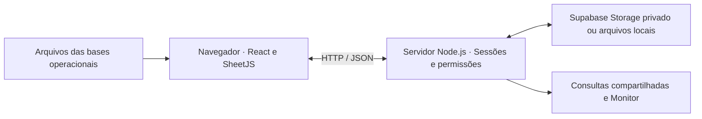

<div align="center">

# SC9 Control

### Visibilidade da operação · Pedidos · Produtividade · Estoque e lotes

**Painel web para transformar bases operacionais em consultas, indicadores e acompanhamento da rotina logística.**


**[Visão geral](#visão-geral)** · **[Recursos](#recursos-principais)** · **[Arquitetura](#como-funciona)** · **[Executar](#execução-local)** · **[Configuração](#configuração)** · **[Documentação](#documentação-e-histórico)**

</div>

---

## Visão geral

O **SC9 Control** reúne informações de pedidos, separação, conferência, expedição, produtividade e estoque em uma interface acessível pelo navegador. O objetivo é facilitar a consulta das bases importadas, identificar pendências e apoiar o acompanhamento da operação por diferentes perfis de acesso.

Em vez de consultar cada planilha isoladamente, a equipe pode navegar pelos indicadores, abrir os pedidos correspondentes, analisar produtos e lotes e registrar as ações disponíveis ao seu perfil.

> **Origem dos dados:** as bases são atualizadas por importação de arquivos. A atualização automática do Monitor consulta os dados disponíveis no servidor; ela não representa uma conexão contínua com o Protheus.

## Recursos principais

| Área | O que oferece |
| --- | --- |
| **Resumo da operação** | Indicadores de pedidos, atrasos, filas de atenção e comparativo por armazém, com consultas na própria página. |
| **Fluxo e expedição** | Acompanhamento de etapas, consulta de pedidos e timeline, confirmação de despacho e registros operacionais. |
| **Monitor** | Consulta periódica da operação do Cambuci, prioridades, indicadores e modo TV. |
| **Produtividade** | Visões de separadores e conferentes, rankings, cobertura dos registros e filtros de análise. |
| **Análises** | Performance, horários, clientes, produtos, Curva ABC, tendências e movimentação. |
| **Estoque e lotes** | Análise de duplicados, validade inconsistente, saldo negativo e vencimentos, com observações e acompanhamento. |
| **Importações SB8** | Prévia de saldos, aplicação controlada, backups e recuperação da posição anterior pelo administrador. |
| **Controle e transferências** | Registros do Controle 02 → 01, bipagem, conferência e histórico. |
| **Administração** | Gestão de usuários, ativação de acessos e atribuição de perfis. |

### Uma navegação para diferentes rotinas

- **Gestão:** visão geral dos pedidos, pendências e indicadores no recorte selecionado.
- **Operação:** consultas e registros de separação, conferência, saída, recebimento e despacho, conforme as permissões.
- **Cadastro:** investigação de lotes, acompanhamento de validade e atualização dos saldos SB8.
- **Análise:** busca, filtros, paginação e exportações disponíveis nas respectivas telas.

A interface adapta a navegação para computador e celular. A busca do menu considera apenas as telas permitidas ao usuário.

## Como funciona



A leitura das planilhas e os cálculos do painel são realizados no navegador. O servidor recebe e persiste os dados processados e os registros das funcionalidades operacionais, aplica as permissões e atende às consultas dos usuários.

Os registros de acompanhamento possuem armazenamento separado da base SC9. Atualizar a base de pedidos não deve ser confundido com substituir históricos ou a posição de saldos SB8.

## Tecnologias

| Camada | Tecnologias |
| --- | --- |
| Interface | React 18, JavaScript, HTML e CSS |
| Estilos e visualização | Tailwind via CDN, estilos próprios e Recharts |
| Leitura de planilhas | SheetJS / XLSX |
| Servidor | Node.js com módulos nativos, sem dependências npm externas |
| Persistência | Supabase Storage ou arquivos locais em `data/` |
| Testes | Executor nativo `node:test` |

O frontend utiliza bibliotecas carregadas por CDN e um `bundle.js` já compilado. As versões e os endereços efetivamente carregados estão em `index.html`.

## Execução local

### Pré-requisitos

- Node.js compatível com `package.json` (`>=18`); prefira uma versão LTS ainda suportada.
- Git para clonar o repositório.
- Internet para carregar as bibliotecas externas da interface.

### 1. Obter o projeto

```bash
git clone https://github.com/Arthurangioletto/sc9-control.git
cd sc9-control
```

### 2. Definir o acesso e iniciar

No PowerShell, configure valores exclusivos para o seu ambiente:

```powershell
$env:APP_PASSWORD = Read-Host "Defina a senha administrativa local"
$env:SESSION_SECRET = [guid]::NewGuid().ToString("N") + [guid]::NewGuid().ToString("N")
npm start
```

Abra [http://localhost:3000](http://localhost:3000). A porta pode ser alterada pela variável `PORT`. Entre como administrador e configure os acessos necessários na administração.

Essas variáveis valem para a sessão atual do terminal. A chave de sessão gerada acima é adequada a um teste local; em uma instalação persistente, mantenha uma chave estável no ambiente do servidor.

Sem configuração de Supabase, o sistema grava arquivos em `data/`. Use bases fictícias para conhecer e validar as telas. Não é necessário compilar o frontend nem instalar dependências npm para iniciar a versão presente neste repositório.

## Configuração

| Variável | Finalidade |
| --- | --- |
| `APP_PASSWORD` | Senha do administrador. Sem esse valor, o código concede acesso administrativo sem autenticação. |
| `SESSION_SECRET` | Chave de assinatura das sessões; mantenha um valor aleatório e estável no servidor. Se ausente, é gerada a cada reinício. |
| `PORT` | Porta HTTP; padrão `3000`. |
| `SUPABASE_URL` | URL do projeto Supabase. |
| `SUPABASE_SERVICE_KEY` | Chave de serviço usada somente pelo servidor para acessar o Storage. |
| `SUPABASE_BUCKET` | Bucket de armazenamento; padrão `sc9-data`. |
| `SUPABASE_GZIP` | Defina `0` para desativar a compressão nas gravações do servidor no Storage. |
| `NODE_ENV` | Use `production` no ambiente publicado, com acesso por HTTPS. |

O projeto lê as variáveis de `process.env`; o comando `npm start` não carrega um arquivo `.env` automaticamente. Configure-as no terminal, no gerenciador do processo ou no provedor de hospedagem.

### Publicação com Render e Supabase

1. Crie um projeto Supabase e um bucket **privado** chamado `sc9-data`, ou ajuste `SUPABASE_BUCKET`.
2. No Render, crie um Web Service conectado ao repositório.
3. Use `npm start` como comando de inicialização. O código entregue já inclui o bundle do frontend e não exige uma etapa de compilação.
4. Configure `APP_PASSWORD`, `SESSION_SECRET`, `SUPABASE_URL`, `SUPABASE_SERVICE_KEY` e `NODE_ENV=production` no ambiente do serviço.
5. Após a publicação, valide login, importação com dados fictícios e acesso por outro navegador. Confira a persistência após reiniciar o serviço.

Em hospedagem com disco efêmero, use armazenamento persistente para conservar os dados entre recriações da instância. Disponibilidade, suspensão por inatividade e limites dependem do plano contratado.

## Acessos e dados

O sistema possui administrador e usuários com combinações dos perfis `geral`, `controle0201`, `saida`, `alteracoes`, `cadastro`, `recebimento`, `despacho`, `transferencia` e `gaveta`. A autorização é aplicada no servidor; a navegação acompanha o acesso permitido.

- As credenciais de serviço do Supabase devem permanecer no ambiente do servidor.
- Planilhas reais, arquivos de `data/`, backups e credenciais devem ficar fora dos commits.
- Importações de saldo SB8 exigem prévia; registros ausentes do arquivo não são automaticamente zerados.
- A recuperação de posição anterior é uma ação administrativa e preserva os achados e observações.
- Filtros de análise delimitam consultas e exportações; não representam uma substituição da base completa.

## Validação

Para executar a suíte automatizada disponível:

```bash
npm test
```

Para verificar a sintaxe dos arquivos de entrada:

```bash
node --check server.js
node --check navigation.js
node --check bundle.js
```

Os testes do repositório incluem cenários de permissões, integridade dos registros, filtros, saldos e integração HTTP. A publicação também deve ser conferida no navegador, incluindo importação, troca de perfis, persistência e navegação em celular.

## Estrutura do projeto

```text
sc9-control/
├── index.html                 # Entrada da interface e bibliotecas via CDN
├── bundle.js                  # Aplicação principal compilada
├── server.js                  # HTTP, autenticação, permissões e persistência
├── storage.js                 # Utilitários de armazenamento
├── navigation.js / .css       # Navegação e componentes visuais compartilhados
├── operation-*.js             # Apresentação das telas operacionais
├── inventory-*.js             # Integridade e apresentação do cadastro
├── stock-*.js                 # Posição e importação de saldos
├── lot-*.js                   # Filtros e registros de lotes
├── expiry-panel.js            # Visão de vencimentos
├── ui-workspaces.js           # Contexto, tabelas e exploração de dados
├── entradas-tdc*.js           # Módulos de entradas TDC
├── tests/                     # Testes automatizados
├── docs/                      # Documentação complementar
└── package.json               # Scripts e requisitos do runtime
```

`data/` é criada em execução quando o armazenamento local é utilizado. O `App.jsx` original não está disponível neste repositório: alterações no bundle exigem cuidado para preservar as integrações existentes.

## Limitações e interpretação dos indicadores

- **Atualização por importação:** o Monitor consulta o servidor periodicamente, mas não importa uma nova base automaticamente.
- **Recorte dos dados:** os indicadores refletem os arquivos disponíveis, os filtros e as regras de cada tela.
- **Produtividade:** intervalos entre registros não comprovam ociosidade, jornada ou capacidade disponível.
- **Estoque:** saldos iguais em importações sucessivas não comprovam ausência de movimentação.
- **Dependências externas:** bloqueios aos CDNs podem impedir o carregamento da interface.
- **Alterações por nota:** o registro de complemento não cria nem altera um pedido no Protheus.
- **Licença:** o repositório não informa uma licença de uso; consulte os responsáveis antes de reutilizar ou distribuir o código.

## Documentação e histórico

O [registro técnico anterior](docs/registro-tecnico-anterior.md) preserva integralmente o README existente antes desta reorganização, incluindo detalhes das funcionalidades e relatos de validação das etapas anteriores. Ele é uma referência histórica; para iniciar e configurar a versão atual, utilize as instruções desta página.

---

<div align="center">
**SC9 Control** · Informação organizada para acompanhar a operação logística.
</div>


## Indicador I 09 · OM e OS do almoxarifado

Módulo aditivo (`indicador-i09.js`, `indicador-i09-ui.js` e as rotas `/api/indicador-i09`). Nenhum arquivo existente foi alterado além de duas linhas de `<script>` no `index.html`, a liberação dos dois arquivos no servidor e o novo bloco de rotas no `server.js`.

Calcula, da SC2 do Protheus, os dois indicadores do BSC I 09 com as mesmas regras da aba Indicators da planilha de controle:

- **OM (o almoxarifado separa):** Mod. OP Montagem Produto Acabado ou Serviço Retrabalho, sequência 01, sem filtro de armazém.
- **OS (o almoxarifado estoca):** Mod. OP Serviço de Componente, Intermediário, Semi-Acabado ou código 4, qualquer sequência e armazém, só produtos usinados (fora da lista Não considera).
- Nos dois: quantidade = Qtd.Produzid, mês = mês da DT Real Fim. O tipo vem da lista Type Korea (código → classificação); sem tipo aparece como "(sem tipo)".
- Perda = coluna Perda; enviado = coluna Quantidade da OP; % de perda = perda ÷ enviado.

**Uso.** O administrador sobe a SC2 do mês no campo "SC2 do mês" da tela inicial (ou em Indicador I 09 → Atualizar base), informa a data da extração e grava. Só o mês enviado é substituído; os demais ficam como estão. O cálculo roda no navegador; o servidor guarda as linhas da SC2 de cada mês (`indicador-i09.json`) e a configuração (`indicador-i09-config.json`: metas de OM e OS, feriados, tipo de cada produto e lista Não considera). Leitura: administrador ou perfil geral; gravação: só administrador.

**Dashboard.** OM e OS lado a lado (% da meta, real, saldo, perda), peças por dia, % da meta acumulada, comparativo, por tipo com % de perda e dia a dia. O Relatório Geral ganha as abas `I09 Dashboard`, `I09 Mês a mês`, `I09 Por tipo` e `I09 Por dia` (mês mais recente da base).

**Primeira vez.** Importe a carga inicial em Atualizar base → Importar base (.json). Os dados da empresa (SC2, tipos de produto) não ficam no repositório.

Validação: `node --test` (modelo e rotas), mais conferência com os números da planilha de controle: OM de Setembro 160.523 e Outubro 163.157; OS de Setembro 278.257 e Outubro 259.969.


## Controle 02 → 01 por recebimento físico e SD3

A aba passa a começar por quem recebe no 01: lote e quantidade recebida, com data, pessoa e identificador gravados pelo servidor. Não exige lançamento de envio pelo 02. A leitura mantém o reconhecimento de códigos/GS1 existente. O histórico anterior de envios e confirmações fica preservado, paginado e exportável em uma seção própria; não é convertido em recebimentos novos nem consome documentos desta conferência.

Usuários com acesso ao Controle 02 → 01, incluindo operadores, importam o SD3 completo do período pela própria aba, confirmam a filial e as datas de cobertura e conferem a prévia antes de aplicar. A atualização substitui somente os movimentos daquela filial dentro do período informado e retém os demais períodos. Arquivos repetidos ou sobrepostos não acumulam saldos. Cada aplicação salva uma cópia de segurança; os recebimentos físicos, SB8 e base global não são substituídos. O arquivo deve incluir as colunas Tipo de movimento, Produto, Quantidade, Armazém, Documento, Data de emissão, Lote e Estornado. Filial e Tipo RE/DE são reconhecidos quando presentes; sem coluna Filial, usa a filial explicitamente selecionada na tela. Movimentos de outros tipos ou sem lote ficam fora da conferência de lotes.

São usados movimentos 999/499, com RE4/DE4 ou RE7/DE7 quando o tipo RE/DE está informado. Estornados e reversões de outros tipos não validam recebimentos. Para conferir, saída do 02 e entrada no 01 precisam compartilhar filial, data, documento, produto e lote e ter quantidades iguais. Entrada em outro armazém ou documento com pontas divergentes é evidência de divergência. A tela identifica o movimento documentado, sem afirmar saldo atual do estoque a partir do SD3.

A regra existente de recebimentos parciais é atendida pela distribuição da quantidade documental entre os registros do mesmo lote/produto/filial, em ordem de recebimento. Uma transferência não pode conferir duas vezes a mesma quantidade. Mantém a janela anterior de dois dias para movimentos que precedem o recebimento; lançamentos posteriores podem regularizar a pendência e ficam identificados pela data documental. Quantidade restante do SD3 sem recebimento é exibida à parte. Lote repetido em produtos diferentes exige identificação do produto antes de conciliar.

Verde: quantidade recebida conciliada. Aguardando SD3: falta cobertura atualizada para a data do recebimento, sem presumir erro pela ausência no arquivo antigo. Vermelho: diferença ou transferência não encontrada no SD3 já coberto. Um arquivo importado antes de um novo recebimento no mesmo dia não comprova ausência desse movimento posterior. O arquivo do dia seguinte permite conferir os recebimentos anteriores. Correções exigem cancelamento com motivo por quem registrou ou administrador; preservam o lançamento original e liberam sua quantidade documental para a conferência dos demais registros.

Persistência separada em controle-recebimentos.json, protegida por perfil controle0201. Importação do SD3 exige perfil controle0201, envio sequencial, prévia, proteção contra concorrência e backup. Cada usuário só pode enviar, conferir, aplicar ou cancelar a importação que ele próprio iniciou. Identidade e data vêm da sessão/servidor; repetição de uma solicitação de recebimento com o mesmo identificador é idempotente. Não há novas dependências. A tela consulta a posição do servidor, oferece busca/filtro e 50 recebimentos por página. Exportação usa o recorte completo e relaciona as quantidades conciliadas aos documentos; histórico antigo tem exportação independente sem limpeza de dados.

Validação: testes do cálculo, parser, servidor e interface cobrem parciais, documentos/filiais/produtos distintos, estornos, atualizações repetidas/sobrepostas, cobertura antiga, lançamento tardio, concorrência, permissões, cancelamento auditado, rascunho/idempotência, exportação completa e preservação das bases antigas. Conferência local no navegador com SD3 CSV fictício: GS1, duas entregas de 4 e 6 conciliadas com 10 transferidas, destino 18 em vermelho, ausência no período coberto em vermelho, produto ambíguo resolvido, recebimento posterior à importação aguardando SD3, páginas de 50 e 7 registros, busca e celular de 390 px sem alargar a página.

A visão de gestão do Controle 02 → 01 usa três indicadores principais e um recorte compartilhado de filial e data do recebimento (horário de São Paulo). O padrão é Últimos 7 dias; Hoje, Personalizado e Todo o histórico permanecem disponíveis. Busca e situação refinam apenas a lista e a exportação, sem alterar os indicadores do período. A conferência documental é calculada sobre todo o histórico antes do recorte visual, preservando a distribuição de entregas parciais.

As prioridades mostram até três recebimentos com divergência ou produto a identificar, com acesso aos registros do lote. Documentos, mensagens complementares e correção ficam nos detalhes do registro. A área de documentos SD3 ainda sem vínculo e o histórico anterior permanecem separados do período de recebimentos, com essa distinção indicada na tela. Novas importações registram o usuário responsável a partir da sessão; importações anteriores não recebem um responsável presumido.

## Relatório de divergências do 59 (Entradas TDC → Exportar relatório)

O modal tem **Imprimir relatório** (abre o relatório e já chama a impressão), **Baixar PDF** (gera e baixa o arquivo direto, sem janela de impressão), **Baixar .html** e **Baixar Excel (dados)**. O PDF é montado no navegador com html2pdf.js (`vendor-html2pdf.js`, MIT, servido pelo próprio servidor): a página do relatório roda escondida, em A4 retrato, e o arquivo sai como `Relatorio_Entradas_TDC_<de>_a_<ate>.pdf`. É um PDF de imagem (o texto não é selecionável); se a biblioteca não carregar, a tela avisa para usar Imprimir e escolher Salvar como PDF. Dentro da própria página do relatório também há os botões Imprimir e Baixar PDF.

## SD3 enviado pelo perfil do TDC (Entradas TDC → Dados)

Quem tem o perfil `alteracoes` (o mesmo que vê Entradas TDC e a análise de alteração pós-faturamento) envia a movimentação (SD3) no quadro "2 · SD3 — movimentação" da aba Dados, além do administrador na tela inicial ("Movimentação interna"). Os dois caminhos gravam a mesma base (`POST /api/movimentacao-analise`, mesmo formato compacto: só linhas com lote), então um envio alimenta o painel do TDC e a análise de alteração. A rota passou de "somente admin" para admin ou perfil `alteracoes`; quem não tem o perfil continua recebendo 403. A leitura da planilha (`detectarColunasSD3`, `lerSD3`, `compactarSD3` em `entradas-tdc.js`) segue as mesmas regras da tela inicial: aba "Movimentação" (ou a primeira com o cabeçalho reconhecido), colunas TP Movimento, Produto, Quantidade, Armazém, Documento, DT Emissão, Usuário, Lote, Tipo RE/DE, Estornado e Valid. Lote. Testes em `tests/entradas-tdc-sd3.test.cjs`.

Correções no Controle 02 → 01 exigem motivo e preservam o lançamento original cancelado, com responsável e data. O botão explicita que salvar o motivo cancela o registro; a quantidade correta é registrada em um novo recebimento. A exportação contém o motivo no recorte e uma aba Correções com os cancelamentos dos recebimentos da filial e período selecionados, independente da busca e situação da lista.

Na conferência, quantidades vinculadas parcialmente a documentos válidos aparecem como Saldo parcial, com a diferença explícita. Sem documento válido correspondente, o registro aguarda cobertura suficiente do SD3 ou aponta divergência quando a cobertura já permite avaliar. Mensagens distinguem quantidade insuficiente, documentos consumidos por outros recebimentos e transferência não encontrada.

Bipagens parciais do Controle 02 → 01 são vinculadas pelas quantidades efetivamente distribuídas aos mesmos documentos válidos, respeitando filial, produto e lote. Uma bipagem de 135 para documento de 245 fica com Saldo parcial; ao receber as 110 restantes, ambas passam a conferidas e descrevem o vínculo. As bipagens permanecem separadas, com seus responsáveis e horários. Um documento já iniciado e ainda aberto pode ser completado depois da janela inicial de dois dias; documentos antigos sem vínculo anterior continuam sujeitos à janela existente.

Recebimento com parte da quantidade conciliada e parte excedente também aparece como Saldo parcial, explicitando o excesso. Novas bipagens não regularizam excesso sem documento correspondente ou correção. Destino incorreto, documentos inválidos, produto ambíguo e ausência de evidência continuam com suas indicações próprias. Cancelar uma bipagem recalcula o grupo e reabre a pendência quando necessário.

A tela mantém três indicadores: Conferidos, Pendentes (parciais e aguardando SD3 discriminados) e Divergências. O filtro de situação distingue Saldo parcial de Aguardando SD3. A exportação inclui uma aba Bipagens parciais, com o grupo completo dos registros exibidos e seus documentos, mesmo quando alguma bipagem está fora do recorte. Totais do grupo são identificados como referência para evitar soma duplicada. Os grupos são calculados no servidor sobre todo o histórico e enviados uma única vez, sem alterar os lançamentos originais.

## I 09: SC2 grava na hora e abas em paisagem no Relatório Geral

- Ao escolher o SC2 (tela inicial ou aba Atualizar base), os meses lidos são gravados automaticamente, desde que nenhum fique com menos linhas do que já está guardado. Se algum mês for ficar menor (arquivo mais antigo ou parcial), a tabela de conferência aparece e a gravação continua dependendo de "Gravar meses marcados".
- As abas `I09 Dashboard`, `I09 Mês a mês`, `I09 Por tipo` e `I09 Por dia` do Relatório Geral saem em orientação paisagem, ajustadas à largura de uma página. O SheetJS gratuito não grava a orientação, então o .xlsx pronto é reaberto (zip) e só essas abas recebem o ajuste (`paisagemXlsx`). Se o navegador não tiver `CompressionStream`, ou o ajuste falhar, o arquivo sai normal, em retrato. Testes em `tests/indicador-i09-paisagem.test.cjs`.

Exportações Excel passam pelo módulo compartilhado export-workbook.js, carregado antes das telas. O módulo normaliza nomes de abas (caracteres proibidos, limite de 31 caracteres, aspas nas extremidades e nomes repetidos) e nomes de arquivos, preservando linhas, tipos e filtros de origem. Erros de geração/download são apresentados e propagados para interromper ações posteriores. A súmula de Entradas TDC usa o mesmo limite de download, mantendo suas larguras e formatos; o gancho do I 09 no Relatório Geral permanece preservado.

Validação da revisão de exportações: botão Excel de atrasados executado a partir da segunda página na cópia local; arquivo baixado e relido com os 88 pedidos do recorte. Geração e releitura adicional com 35 abas representativas das áreas, números fracionados, datas, códigos com zeros e motivos de correção. Dados de teste fictícios; nenhum dado de produção foi alterado.

## Transportadora nas exportações de pedidos

As planilhas geradas a partir de listas de pedidos (atrasados, em aberto, enviados, pedidos críticos, atraso de faturamento, faturados sem despacho e demais listas do recorte) ganharam a coluna **Transportadora**, logo depois do Cliente. O nome vem do SC5 (código → Brasil, São Paulo, Retira 01–04, Emergência; códigos ainda sem nome aparecem como "Código N"), com a coluna do próprio SC9 como alternativa; sem informação, aparece "Não informada". As exportações de Saída, Recebimento e Coleta por transportadora já traziam essa informação.

## Consolidado semanal ou mensal (Cambuci + filiais)

No cabeçalho do painel, o botão **Consolidado** abre uma caixinha para escolher **Semana** (segunda a domingo) ou **Mês** e baixa o Excel `Consolidado_Cambuci_09a13Nov2026.xlsx` (ou `…Novembro2026.xlsx`). O padrão é o último período fechado; o que ainda está em andamento aparece como "(parcial)". Usa só o que já está carregado no painel (SC9, SC5, Entrega e nomes dos itens), sem subir nada novo. Cálculo em `consolidado.js`, botão em `consolidado-ui.js`.

- **Abas:** Dashboard (totais, status, por armazém, tendência diária e, no mês, por semana), Base de Dados (um pedido por linha, com NF, status, separador, conferente e transportadora, com filtro), Ranking Itens por Armazém (top 10 em peças, com o nome do item) e Por Transportadora. O Excel sai com o mesmo desenho do dashboard: título azul, cartões de KPI, tabelas coloridas, barras de dados, dois gráficos nativos (pedidos por dia Enviado × Atrasado × Pendente, e Pedidos × Peças em dois eixos) e, no mês, a tabela por semana. Na Base de Dados o status é colorido; Ranking e Transportadora têm barras e linha de Total. Geração em `consolidado-xlsx.js` (ExcelJS + JSZip, carregados só ao clicar em `vendor-exceljs.js` e `vendor-jszip.js`, com as licenças ao lado). Se algo falhar, baixa o Excel simples de antes (sem cores e gráficos) e avisa.
- **Regras (as mesmas dos consolidados feitos antes fora do sistema):** armazéns Cambuci, BH, CE, DF e RJ; Tamboré e pedidos com Implacil no nome do cliente (transferência interna) ficam de fora; as regras de bloqueio e itens "IP" já vêm do painel. Cambuci = Enviado se o pedido está na Entrega; sem Entrega mas separado e conferido = Pendente; senão Atrasado. Filiais = Enviado só precisa de NF; sem NF e liberado antes do corte (último dia do período) = Atrasado.
- **Pedido liberado em partes:** conta em cada período só com as linhas liberadas naquele período, igual aos consolidados anteriores. Por isso o total do mês pode diferir da soma das semanas.
- **Transportadora:** vem do SC5 (código sem zeros à esquerda → nome); `10085` aparece como TCS (é o que a aba Entrega registra para esses pedidos); códigos sem nome seguem como "Código N" e sem informação como "(não definida)".
- **Datas numéricas:** exportações do Protheus trazem Dt Fim Pick / Dt Fim Conf como número (serial do Excel) nas linhas mais recentes. O painel passou a ler esses números como data; antes essas linhas apareciam como "não separadas".
- **Validação:** o consolidado de 09 a 13/11/2026 gerado no navegador com a base de 17/11 bate coluna a coluna com o que foi feito à mão (1.165 pedidos, 33.494 peças, 1.154 enviados, 4 atrasados, 7 pendentes). Testes em `tests/consolidado.test.cjs` e `tests/consolidado-xlsx.test.cjs`. No Excel estilizado os números são os mesmos; só muda a ordem de itens empatados no Ranking.

## Relatório Geral com visual novo e botão Histórico de Atraso

O botão **Relatório Geral** do painel baixa o Excel com o mesmo desenho do Consolidado (faixa azul, cartões de indicadores, tabelas com cabeçalho azul e listras, barras de %, gráfico na Tendência Diária). As abas e colunas são as mesmas de antes (Resumo, Por Armazém, Tendência Diária e Semanal, Top 5 Itens, Top Separadores, Alertas); porcentagens e datas viram valores de verdade do Excel. Geração em `relatorio-geral-xlsx.js` (ExcelJS + JSZip, `vendor-exceljs.js` e `vendor-jszip.js`, carregados só ao clicar). Se algo falhar, baixa o Excel simples de antes.

Ao lado dele fica o botão **Histórico de Atraso** (`atraso-historico-ui.js`, Excel em `atraso-historico-xlsx.js`): escolhe o mês e baixa `SC9_Historico_Atraso_AAAA-MM.xlsx`.

- **Resumo do Mês:** cartões do último dia, dois gráficos (% de atraso de estoque × faturamento por dia; entraram × saíram por dia) e a tabela dia a dia (pedidos na base, atraso de estoque e de faturamento em pedidos, peças e %, total, entraram, saíram, continuam e uma frase de comparativo). O dia é um link para a aba dele.
- **Uma aba por dia (DD-MM-AAAA, a mais recente primeiro):** cartões, o **comparativo com o dia anterior gravado** (frase "Melhorou/Piorou/Igual", tabela dia anterior → saíram → continuam → entraram → hoje), a lista dos pedidos em atraso (pedido, armazém, liberado em, dias de atraso, **peças**, **transportadora**, tipo, situação e se é novo, continua ou mudou de tipo) com filtro, e ao lado a lista dos que **saíram do atraso** desde o dia anterior. O comparativo atravessa a virada do mês.
- **Transportadora e peças:** a transportadora vem do SC5 pelo número do pedido (código → nome, a mesma tabela do Consolidado); peças é a quantidade liberada do pedido.
- **Não apaga nada:** clicar em Baixar grava a foto de hoje (e a carga do SC9 pelo administrador também grava) em `atraso-historico-AAAA-MM.json`, um arquivo por mês; o mesmo dia é trocado pela versão mais recente e os outros ficam. Rotas `GET/POST /api/atraso-historico` (somente administrador); regras em `atraso-historico.js`.
- **Regras:** *Faturamento* = sem nota, já separado e conferido (entra também "em processo", como o "Atraso Faturamento" do Resumo). *Estoque* = qualquer outro pedido Atrasado (ainda não separado/conferido ou, se já tem nota, ainda sem saída na Entrega), o mesmo "Atrasados" do painel. % = pedidos em atraso ÷ pedidos da base no dia. "Saiu do atraso" = estava na lista do dia anterior e não está mais (enviado, faturado ou regularizado).
- **Só passa a existir daqui para frente:** dias anteriores à primeira foto gravada depois desta versão não existem; o primeiro dia sai sem comparativo.
- **Validação:** com a base real de 17/11 no navegador, o Resumo bate com a aba do dia (Atrasados 144 = 142 de estoque + 2 de faturamento), as transportadoras aparecem e dias gravados antes continuam no arquivo. Testes em `tests/relatorio-geral-xlsx.test.cjs`, `tests/atraso-historico-xlsx.test.cjs` e `tests/atraso-historico-server.test.cjs`.

## Página do Histórico de Atraso (link fixo)

`/historico-atraso.html` (arquivos `historico-atraso.html` e `historico-atraso.js`) mostra, no navegador, tudo o que o Histórico de Atraso já grava por dia no servidor, sem baixar Excel. Quem abre o link já logado no SC9 (administrador ou perfil `geral`) entra direto; se não, a própria página pede usuário e senha.

- **Escolha o dia:** faixa com todos os dias do mês (dias sem foto aparecem apagados). `#AAAA-MM-DD` no endereço abre um dia específico; "Copiar link deste dia" gera esse endereço.
- **Detalhe do dia:** frase do comparativo com o dia anterior, cartões (em atraso, estoque, faturamento, peças em atraso, pedidos e peças despachados) com a variação, e a lista de pedidos em três abas: Em atraso, Entraram e Saíram do atraso. Filtros por tipo, situação, armazém, transportadora e busca; colunas ordenáveis; "Baixar lista (CSV)". Clicar num pedido abre todos os dados dele e os dias em que apareceu no atraso.
- **Despacho por dia:** `GET /api/atraso-historico` agora também devolve `expedicao` com, por dia, os pedidos (sem repetir o mesmo pedido) e as peças da Saída p/ Expedição. O resumo de cada dia fica em `atraso-expedicao-AAAA-MM.json` para não se perder quando o administrador exporta e apaga dias antigos da saída.
- A gravação da foto continua só do administrador; a leitura passou a aceitar também o perfil `geral`.
- No painel, o botão **Histórico de Atraso** ganhou o atalho "Abrir a página do histórico".

## Transferência (aba por perfil)

Cópia do fluxo do Retem 26 (`transferencia-de-lotes.html`, `operation-transferencia.js`, `transferencia-inventory.js`), liberada por usuário no perfil `transferencia` (admin sempre vê). Diferenças em relação ao Retem:

- Lê somente o saldo do armazém **59** no SB8 e soma as linhas do mesmo produto e lote.
- Mostra o endereço de destino no armazém **02** a partir da aba ZZ2, cruzando filial, produto e lote quando disponível.
- A bipagem mostra o saldo do 59 e avisa quando a contagem excede esse saldo.
- A quantidade conferida pode ser **editada direto** na tabela.
- A exportação soma as quantidades por filial, produto, lote e armazém de origem nas duas abas. O destino é escolhido na tela Documentos (padrão 02; quem já tinha salvo 01 nesse navegador escolhe 02 uma vez).
- Transferência e Retem salvam os documentos no servidor com numeração própria (`TRF-000001` e `DOC-000001`). Operadores consultam e editam somente os próprios documentos conforme o perfil de cada aba. O administrador consulta todos e pode importar documentos antigos no navegador onde foram criados. O histórico antigo é identificado sem atribuir autoria.
- Em cada aba, o comparativo do administrador usa um arquivo SD3 com filial e reúne os documentos finalizados na data selecionada. Mantém as referências dos documentos SC9 para cada lote e rota.
- Em **Visualizar documentos**, somente o administrador pode exportar dois ou mais documentos finalizados num Excel consolidado. A aba **Transferência múltipla** soma por produto, lote e armazém de origem. O **Resumo** identifica o documento original de cada lançamento.
- No Retem, **Retornos do Retem** usa o SB8 com data de fabricação para listar os lotes com saldo no 26 que já completaram dois anos ou completam nos próximos 90 dias. A aba ZZ2 do mesmo arquivo fornece o endereço no 01. O painel filtra e exporta pelo mês previsto de retorno, e a última importação fica salva no navegador.

## Análise de gaveta (celular e tablet)

Aba nova, liberada por usuário no perfil `gaveta` (o administrador sempre vê). A tela ocupa o aparelho todo e foi feita para o dedo: botões grandes, campos de 16px, barra de ação fixa embaixo e dois níveis de layout (celular e tablet).

**Carga (administrador, aba Bases):** escolha o SB8, o ZZ2 e o SB1 do Protheus (um por vez ou juntos; o sistema reconhece cada aba pelos cabeçalhos). O SB8 é lido no navegador e só vão para o servidor as linhas com saldo maior que zero e não excluídas. O SB8 completo (~65 MB, ~418 mil linhas) vira um XML de ~850 MB dentro do .xlsx e o leitor comum de Excel do navegador o descarta sem avisar; por isso, quando isso acontece, o arquivo é aberto aos pedaços (leitura em fluxo, só as colunas necessárias, ~15 s) e sobem cerca de 46 mil linhas. Exige navegador atual (Chrome/Edge/Safari 16.4+/Firefox 113+) no computador do administrador.

**Na tela do celular/iPhone:**
- Cada produto mostra primeiro o armazém da gaveta (01). Os lotes aparecem **fechados** (só o número); ao tocar abrem saldo, validade, o campo de validade correta e **onde o lote está** nos outros armazéns, com o botão de transferir.
- Se o produto não tem saldo no 01, "Também em outros armazéns" já abre sozinho. A ordem de consulta é 01, 02, 59, 30, 20, 25, ES, BH, DF, RJ, CE, ET, BT, RT, CT, DT; qualquer outro armazém aparece depois, em "Demais armazéns".
- A **lupa** (ou Enter) pesquisa o lote em todos os armazéns do SB8: se está nesta gaveta, o lote abre; se está em outro lugar, lista os armazéns e endereços; se não existe saldo, avisa claramente (dá para anotar como encontrado).
- O botão de **código de barras** (na lista de gavetas e no campo do lote) abre a câmera traseira e lê o código de barras da gaveta (Code 128, Code 39, EAN, QR etc.; aceita só o número, texto com prefixo, URL ou 1 caractere extra de verificação). Usa o leitor do navegador quando existe e, no iPhone, o ZXing (arquivo `vendor-zxing.js`, MIT, só carregado ao abrir a câmera). Precisa de conexão segura (https) e da permissão da câmera.
- Cada lote tem a caixa **Lote analisado** (confirmação de que conferiu o lote e a validade). O produto só pode ser marcado como **Conferido** com todos os lotes analisados (há um botão para marcar todos de uma vez). A análise grava, por lote, saldo, validade do SB8, validade informada e se foi analisado.
- **Exportar análises** (Painel, administrador) gera 3 abas: **Lotes** (uma linha por lote, com saldo, validades, situação, "Analisado", e também as linhas de produto sem saldo, lote a transferir e lote fora do cadastro), **Gavetas** (resumo por gaveta) e **Transferir p-01**.
- Na lista, **Gavetas / Armários** separa os endereços `ZARM…` (armários, com dezenas de produtos) das gavetas.
- **Contagem física por lote.** Em cada lote o operador informa *quantas peças achou na gaveta* (o lote abre sozinho ao bipar). O sistema compara com o saldo do armazém da gaveta: **confere**; **falta no físico** (achou menos); ou, se achou mais, mostra *"N un. encontrada(s) em outro armazém: 1 do 59, 4 do ES"* (armazéns na ordem de prioridade, só o que cobre a diferença) com um botão que já marca essa transferência, e **sobra sem saldo no sistema** quando nenhum armazém cobre o resto. Vale também para lote que o SB8 só tem em outro armazém (aparece em *Também em outros armazéns*) e, pela lupa, para lote fora do cadastro da gaveta (guarda a quantidade achada e onde o sistema tem saldo). A tag do lote mostra o resultado e a finalização traz "Lotes contados · com diferença". A exportação (aba Lotes) ganhou **Qtd física**, **Diferença (físico − saldo)** e **Contagem**; a aba Gavetas ganhou lotes contados e divergências. A contagem é opcional.
- **Localização do produto na lupa.** Além do lote, a lupa aceita **código, EAN ou descrição** e mostra onde o produto mora (gavetas do ZZ2, por armazém). Se não é desta gaveta aparece *"Não é desta gaveta. Gaveta certa: Arm. 01 · AB9"*; se é, *"Este produto é desta gaveta"* com botão para ir direto ao produto.
- **Tirar de outro armazém.** Em cada armazém de *Também em outros armazéns* há o campo *"Quantas tirou do arm. X?"*: digitar a quantidade marca a transferência para o armazém da gaveta (vazio ou 0 desmarca) e avisa se passa do saldo daquele armazém.
- **Exportação (aba Lotes).** Lote achado que só tem saldo em outro armazém sai com o **armazém de origem** na coluna Armazém (e *Saldo no sistema: arm. 59 (3)* na Observação), não mais o da gaveta.

- **SB8 vale 24 horas.** Passou disso sem ser atualizado, o servidor apaga o SB8 e quem analisa deixa de ver a base (a lista de gavetas e o painel continuam).
- **ZZ2 e SB1** (endereços e descrições) ficam até serem trocados. Cada endereço do ZZ2 num armazém/filial é uma **gaveta**.
- **As análises feitas nunca são apagadas** (`gaveta-analises.json`). O painel conta gavetas analisadas por dia, quantas faltam, média por dia, tempo médio por gaveta e quem analisou hoje; o administrador exporta tudo em Excel.

**Análise:** a pessoa escolhe a gaveta e vê, por produto, todos os endereços cadastrados no ZZ2, os lotes com saldo e a validade no armazém da gaveta (colorida: vencido, até 30 dias, até 90 dias, válido) e o saldo em outros armazéns (59, ES, 20…). Pode:

- bipar/digitar um **lote** no topo: se está na gaveta, vai até o produto; se não está, mostra onde o saldo está e permite anotar "encontrado nesta gaveta";
- **corrigir a validade** do lote (a correção fica gravada na análise, o SB8 não é alterado);
- marcar um lote de outro armazém como **transferir para o armazém da gaveta**, com quantidade e observação;
- deixar observação e tocar em **Conferido**. A gaveta só fecha com todos os produtos conferidos; o rascunho fica salvo no aparelho e reenvio não duplica.
