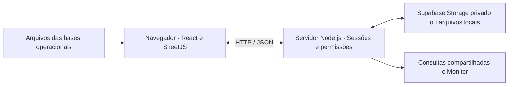

<div align="center">

# SC9 Control

### Visibilidade da operação · Pedidos · Produtividade · Estoque e lotes

**Painel web para transformar bases operacionais em consultas, indicadores e acompanhamento da rotina logística.**


**[Visão geral](#visão-geral)** · **[Recursos](#recursos-principais)** · **[Arquitetura](#como-funciona)** · **[Executar](#execução-local)** · **[Configuração](#configuração)** · **[Documentação](#documentação-e-histórico)**

</div>

---

## Visão geral

O **SC9 Control** reúne informações de pedidos, separação, conferência, expedição, produtividade e estoque em uma interface acessível pelo navegador. O objetivo é facilitar a consulta das bases importadas, identificar pendências e apoiar o acompanhamento da operação por diferentes perfis de acesso.

Em vez de consultar cada planilha isoladamente, a equipe pode navegar pelos indicadores, abrir os pedidos correspondentes, analisar produtos e lotes e registrar as ações disponíveis ao seu perfil.

> **Origem dos dados:** as bases são atualizadas por importação de arquivos. A atualização automática do Monitor consulta os dados disponíveis no servidor; ela não representa uma conexão contínua com o Protheus.

## Recursos principais

| Área | O que oferece |
| --- | --- |
| **Resumo da operação** | Indicadores de pedidos, atrasos, filas de atenção e comparativo por armazém, com consultas na própria página. |
| **Fluxo e expedição** | Acompanhamento de etapas, consulta de pedidos e timeline, confirmação de despacho e registros operacionais. |
| **Monitor** | Consulta periódica da operação do Cambuci, prioridades, indicadores e modo TV. |
| **Produtividade** | Visões de separadores e conferentes, rankings, cobertura dos registros e filtros de análise. |
| **Análises** | Performance, horários, clientes, produtos, Curva ABC, tendências e movimentação. |
| **Estoque e lotes** | Análise de duplicados, validade inconsistente, saldo negativo e vencimentos, com observações e acompanhamento. |
| **Importações SB8** | Prévia de saldos, aplicação controlada, backups e recuperação da posição anterior pelo administrador. |
| **Controle e transferências** | Registros do Controle 02 → 01, bipagem, conferência e histórico. |
| **Administração** | Gestão de usuários, ativação de acessos e atribuição de perfis. |

### Uma navegação para diferentes rotinas

- **Gestão:** visão geral dos pedidos, pendências e indicadores no recorte selecionado.
- **Operação:** consultas e registros de separação, conferência, saída, recebimento e despacho, conforme as permissões.
- **Cadastro:** investigação de lotes, acompanhamento de validade e atualização dos saldos SB8.
- **Análise:** busca, filtros, paginação e exportações disponíveis nas respectivas telas.

A interface adapta a navegação para computador e celular. A busca do menu considera apenas as telas permitidas ao usuário.

## Como funciona



A leitura das planilhas e os cálculos do painel são realizados no navegador. O servidor recebe e persiste os dados processados e os registros das funcionalidades operacionais, aplica as permissões e atende às consultas dos usuários.

Os registros de acompanhamento possuem armazenamento separado da base SC9. Atualizar a base de pedidos não deve ser confundido com substituir históricos ou a posição de saldos SB8.

## Tecnologias

| Camada | Tecnologias |
| --- | --- |
| Interface | React 18, JavaScript, HTML e CSS |
| Estilos e visualização | Tailwind via CDN, estilos próprios e Recharts |
| Leitura de planilhas | SheetJS / XLSX |
| Servidor | Node.js com módulos nativos, sem dependências npm externas |
| Persistência | Supabase Storage ou arquivos locais em `data/` |
| Testes | Executor nativo `node:test` |

O frontend utiliza bibliotecas carregadas por CDN e um `bundle.js` já compilado. As versões e os endereços efetivamente carregados estão em `index.html`.

## Execução local

### Pré-requisitos

- Node.js compatível com `package.json` (`>=18`); prefira uma versão LTS ainda suportada.
- Git para clonar o repositório.
- Internet para carregar as bibliotecas externas da interface.

### 1. Obter o projeto

```bash
git clone https://github.com/Arthurangioletto/sc9-control.git
cd sc9-control
```

### 2. Definir o acesso e iniciar

No PowerShell, configure valores exclusivos para o seu ambiente:

```powershell
$env:APP_PASSWORD = Read-Host "Defina a senha administrativa local"
$env:SESSION_SECRET = [guid]::NewGuid().ToString("N") + [guid]::NewGuid().ToString("N")
npm start
```

Abra [http://localhost:3000](http://localhost:3000). A porta pode ser alterada pela variável `PORT`. Entre como administrador e configure os acessos necessários na administração.

Essas variáveis valem para a sessão atual do terminal. A chave de sessão gerada acima é adequada a um teste local; em uma instalação persistente, mantenha uma chave estável no ambiente do servidor.

Sem configuração de Supabase, o sistema grava arquivos em `data/`. Use bases fictícias para conhecer e validar as telas. Não é necessário compilar o frontend nem instalar dependências npm para iniciar a versão presente neste repositório.

## Configuração

| Variável | Finalidade |
| --- | --- |
| `APP_PASSWORD` | Senha do administrador. Sem esse valor, o código concede acesso administrativo sem autenticação. |
| `SESSION_SECRET` | Chave de assinatura das sessões; mantenha um valor aleatório e estável no servidor. Se ausente, é gerada a cada reinício. |
| `PORT` | Porta HTTP; padrão `3000`. |
| `SUPABASE_URL` | URL do projeto Supabase. |
| `SUPABASE_SERVICE_KEY` | Chave de serviço usada somente pelo servidor para acessar o Storage. |
| `SUPABASE_BUCKET` | Bucket de armazenamento; padrão `sc9-data`. |
| `SUPABASE_GZIP` | Defina `0` para desativar a compressão nas gravações do servidor no Storage. |
| `NODE_ENV` | Use `production` no ambiente publicado, com acesso por HTTPS. |

O projeto lê as variáveis de `process.env`; o comando `npm start` não carrega um arquivo `.env` automaticamente. Configure-as no terminal, no gerenciador do processo ou no provedor de hospedagem.

### Publicação com Render e Supabase

1. Crie um projeto Supabase e um bucket **privado** chamado `sc9-data`, ou ajuste `SUPABASE_BUCKET`.
2. No Render, crie um Web Service conectado ao repositório.
3. Use `npm start` como comando de inicialização. O código entregue já inclui o bundle do frontend e não exige uma etapa de compilação.
4. Configure `APP_PASSWORD`, `SESSION_SECRET`, `SUPABASE_URL`, `SUPABASE_SERVICE_KEY` e `NODE_ENV=production` no ambiente do serviço.
5. Após a publicação, valide login, importação com dados fictícios e acesso por outro navegador. Confira a persistência após reiniciar o serviço.

Em hospedagem com disco efêmero, use armazenamento persistente para conservar os dados entre recriações da instância. Disponibilidade, suspensão por inatividade e limites dependem do plano contratado.

## Acessos e dados

O sistema possui administrador e usuários com combinações dos perfis `geral`, `controle0201`, `saida`, `alteracoes`, `cadastro`, `recebimento` e `despacho`. A autorização é aplicada no servidor; a navegação acompanha o acesso permitido.

- As credenciais de serviço do Supabase devem permanecer no ambiente do servidor.
- Planilhas reais, arquivos de `data/`, backups e credenciais devem ficar fora dos commits.
- Importações de saldo SB8 exigem prévia; registros ausentes do arquivo não são automaticamente zerados.
- A recuperação de posição anterior é uma ação administrativa e preserva os achados e observações.
- Filtros de análise delimitam consultas e exportações; não representam uma substituição da base completa.

## Validação

Para executar a suíte automatizada disponível:

```bash
npm test
```

Para verificar a sintaxe dos arquivos de entrada:

```bash
node --check server.js
node --check navigation.js
node --check bundle.js
```

Os testes do repositório incluem cenários de permissões, integridade dos registros, filtros, saldos e integração HTTP. A publicação também deve ser conferida no navegador, incluindo importação, troca de perfis, persistência e navegação em celular.

## Estrutura do projeto

```text
sc9-control/
├── index.html                 # Entrada da interface e bibliotecas via CDN
├── bundle.js                  # Aplicação principal compilada
├── server.js                  # HTTP, autenticação, permissões e persistência
├── storage.js                 # Utilitários de armazenamento
├── navigation.js / .css       # Navegação e componentes visuais compartilhados
├── operation-*.js             # Apresentação das telas operacionais
├── inventory-*.js             # Integridade e apresentação do cadastro
├── stock-*.js                 # Posição e importação de saldos
├── lot-*.js                   # Filtros e registros de lotes
├── expiry-panel.js            # Visão de vencimentos
├── ui-workspaces.js           # Contexto, tabelas e exploração de dados
├── entradas-tdc*.js           # Módulos de entradas TDC
├── tests/                     # Testes automatizados
├── docs/                      # Documentação complementar
└── package.json               # Scripts e requisitos do runtime
```

`data/` é criada em execução quando o armazenamento local é utilizado. O `App.jsx` original não está disponível neste repositório: alterações no bundle exigem cuidado para preservar as integrações existentes.

## Limitações e interpretação dos indicadores

- **Atualização por importação:** o Monitor consulta o servidor periodicamente, mas não importa uma nova base automaticamente.
- **Recorte dos dados:** os indicadores refletem os arquivos disponíveis, os filtros e as regras de cada tela.
- **Produtividade:** intervalos entre registros não comprovam ociosidade, jornada ou capacidade disponível.
- **Estoque:** saldos iguais em importações sucessivas não comprovam ausência de movimentação.
- **Dependências externas:** bloqueios aos CDNs podem impedir o carregamento da interface.
- **Alterações por nota:** o registro de complemento não cria nem altera um pedido no Protheus.
- **Licença:** o repositório não informa uma licença de uso; consulte os responsáveis antes de reutilizar ou distribuir o código.

## Documentação e histórico

O [registro técnico anterior](docs/registro-tecnico-anterior.md) preserva integralmente o README existente antes desta reorganização, incluindo detalhes das funcionalidades e relatos de validação das etapas anteriores. Ele é uma referência histórica; para iniciar e configurar a versão atual, utilize as instruções desta página.

---

<div align="center">
**SC9 Control** · Informação organizada para acompanhar a operação logística.
</div>


## Indicador I 09 · OM e OS do almoxarifado

Módulo aditivo (`indicador-i09.js`, `indicador-i09-ui.js` e as rotas `/api/indicador-i09`). Nenhum arquivo existente foi alterado além de duas linhas de `<script>` no `index.html`, a liberação dos dois arquivos no servidor e o novo bloco de rotas no `server.js`.

Calcula, da SC2 do Protheus, os dois indicadores do BSC I 09 com as mesmas regras da aba Indicators da planilha de controle:

- **OM (o almoxarifado separa):** Mod. OP Montagem Produto Acabado ou Serviço Retrabalho, sequência 01, sem filtro de armazém.
- **OS (o almoxarifado estoca):** Mod. OP Serviço de Componente, Intermediário, Semi-Acabado ou código 4, qualquer sequência e armazém, só produtos usinados (fora da lista Não considera).
- Nos dois: quantidade = Qtd.Produzid, mês = mês da DT Real Fim. O tipo vem da lista Type Korea (código → classificação); sem tipo aparece como "(sem tipo)".
- Perda = coluna Perda; enviado = coluna Quantidade da OP; % de perda = perda ÷ enviado.

**Uso.** O administrador sobe a SC2 do mês no campo "SC2 do mês" da tela inicial (ou em Indicador I 09 → Atualizar base), informa a data da extração e grava. Só o mês enviado é substituído; os demais ficam como estão. O cálculo roda no navegador; o servidor guarda as linhas da SC2 de cada mês (`indicador-i09.json`) e a configuração (`indicador-i09-config.json`: metas de OM e OS, feriados, tipo de cada produto e lista Não considera). Leitura: administrador ou perfil geral; gravação: só administrador.

**Dashboard.** OM e OS lado a lado (% da meta, real, saldo, perda), peças por dia, % da meta acumulada, comparativo, por tipo com % de perda e dia a dia. O Relatório Geral ganha as abas `I09 Dashboard`, `I09 Mês a mês`, `I09 Por tipo` e `I09 Por dia` (mês mais recente da base).

**Primeira vez.** Importe a carga inicial em Atualizar base → Importar base (.json). Os dados da empresa (SC2, tipos de produto) não ficam no repositório.

Validação: `node --test` (modelo e rotas), mais conferência com os números da planilha de controle: OM de Setembro 160.523 e Outubro 163.157; OS de Setembro 278.257 e Outubro 259.969.


## Controle 02 → 01 por recebimento físico e SD3

A aba passa a começar por quem recebe no 01: lote e quantidade recebida, com data, pessoa e identificador gravados pelo servidor. Não exige lançamento de envio pelo 02. A leitura mantém o reconhecimento de códigos/GS1 existente. O histórico anterior de envios e confirmações fica preservado, paginado e exportável em uma seção própria; não é convertido em recebimentos novos nem consome documentos desta conferência.

Usuários com acesso ao Controle 02 → 01, incluindo operadores, importam o SD3 completo do período pela própria aba, confirmam a filial e as datas de cobertura e conferem a prévia antes de aplicar. A atualização substitui somente os movimentos daquela filial dentro do período informado e retém os demais períodos. Arquivos repetidos ou sobrepostos não acumulam saldos. Cada aplicação salva uma cópia de segurança; os recebimentos físicos, SB8 e base global não são substituídos. O arquivo deve incluir as colunas Tipo de movimento, Produto, Quantidade, Armazém, Documento, Data de emissão, Lote e Estornado. Filial e Tipo RE/DE são reconhecidos quando presentes; sem coluna Filial, usa a filial explicitamente selecionada na tela. Movimentos de outros tipos ou sem lote ficam fora da conferência de lotes.

São usados movimentos 999/499, com RE4/DE4 ou RE7/DE7 quando o tipo RE/DE está informado. Estornados e reversões de outros tipos não validam recebimentos. Para conferir, saída do 02 e entrada no 01 precisam compartilhar filial, data, documento, produto e lote e ter quantidades iguais. Entrada em outro armazém ou documento com pontas divergentes é evidência de divergência. A tela identifica o movimento documentado, sem afirmar saldo atual do estoque a partir do SD3.

A regra existente de recebimentos parciais é atendida pela distribuição da quantidade documental entre os registros do mesmo lote/produto/filial, em ordem de recebimento. Uma transferência não pode conferir duas vezes a mesma quantidade. Mantém a janela anterior de dois dias para movimentos que precedem o recebimento; lançamentos posteriores podem regularizar a pendência e ficam identificados pela data documental. Quantidade restante do SD3 sem recebimento é exibida à parte. Lote repetido em produtos diferentes exige identificação do produto antes de conciliar.

Verde: quantidade recebida conciliada. Aguardando SD3: falta cobertura atualizada para a data do recebimento, sem presumir erro pela ausência no arquivo antigo. Vermelho: diferença ou transferência não encontrada no SD3 já coberto. Um arquivo importado antes de um novo recebimento no mesmo dia não comprova ausência desse movimento posterior. O arquivo do dia seguinte permite conferir os recebimentos anteriores. Correções exigem cancelamento com motivo por quem registrou ou administrador; preservam o lançamento original e liberam sua quantidade documental para a conferência dos demais registros.

Persistência separada em controle-recebimentos.json, protegida por perfil controle0201. Importação do SD3 exige perfil controle0201, envio sequencial, prévia, proteção contra concorrência e backup. Cada usuário só pode enviar, conferir, aplicar ou cancelar a importação que ele próprio iniciou. Identidade e data vêm da sessão/servidor; repetição de uma solicitação de recebimento com o mesmo identificador é idempotente. Não há novas dependências. A tela consulta a posição do servidor, oferece busca/filtro e 50 recebimentos por página. Exportação usa o recorte completo e relaciona as quantidades conciliadas aos documentos; histórico antigo tem exportação independente sem limpeza de dados.

Validação: testes do cálculo, parser, servidor e interface cobrem parciais, documentos/filiais/produtos distintos, estornos, atualizações repetidas/sobrepostas, cobertura antiga, lançamento tardio, concorrência, permissões, cancelamento auditado, rascunho/idempotência, exportação completa e preservação das bases antigas. Conferência local no navegador com SD3 CSV fictício: GS1, duas entregas de 4 e 6 conciliadas com 10 transferidas, destino 18 em vermelho, ausência no período coberto em vermelho, produto ambíguo resolvido, recebimento posterior à importação aguardando SD3, páginas de 50 e 7 registros, busca e celular de 390 px sem alargar a página.

A visão de gestão do Controle 02 → 01 usa três indicadores principais e um recorte compartilhado de filial e data do recebimento (horário de São Paulo). O padrão é Últimos 7 dias; Hoje, Personalizado e Todo o histórico permanecem disponíveis. Busca e situação refinam apenas a lista e a exportação, sem alterar os indicadores do período. A conferência documental é calculada sobre todo o histórico antes do recorte visual, preservando a distribuição de entregas parciais.

As prioridades mostram até três recebimentos com divergência ou produto a identificar, com acesso aos registros do lote. Documentos, mensagens complementares e correção ficam nos detalhes do registro. A área de documentos SD3 ainda sem vínculo e o histórico anterior permanecem separados do período de recebimentos, com essa distinção indicada na tela. Novas importações registram o usuário responsável a partir da sessão; importações anteriores não recebem um responsável presumido.
