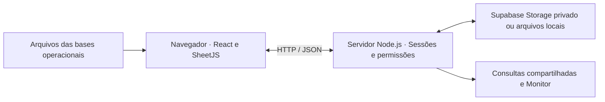

<div align="center">

# SC9 Control

### Visibilidade da operação · Pedidos · Produtividade · Estoque e lotes

**Painel web para transformar bases operacionais em consultas, indicadores e acompanhamento da rotina logística.**


**[Visão geral](#visão-geral)** · **[Recursos](#recursos-principais)** · **[Arquitetura](#como-funciona)** · **[Executar](#execução-local)** · **[Configuração](#configuração)** · **[Documentação](#documentação-e-histórico)**

</div>

---

## Visão geral

O **SC9 Control** reúne informações de pedidos, separação, conferência, expedição, produtividade e estoque em uma interface acessível pelo navegador. O objetivo é facilitar a consulta das bases importadas, identificar pendências e apoiar o acompanhamento da operação por diferentes perfis de acesso.

Em vez de consultar cada planilha isoladamente, a equipe pode navegar pelos indicadores, abrir os pedidos correspondentes, analisar produtos e lotes e registrar as ações disponíveis ao seu perfil.

> **Origem dos dados:** as bases são atualizadas por importação de arquivos. A atualização automática do Monitor consulta os dados disponíveis no servidor; ela não representa uma conexão contínua com o Protheus.

## Recursos principais

| Área | O que oferece |
| --- | --- |
| **Resumo da operação** | Indicadores de pedidos, atrasos, filas de atenção e comparativo por armazém, com consultas na própria página. |
| **Fluxo e expedição** | Acompanhamento de etapas, consulta de pedidos e timeline, confirmação de despacho e registros operacionais. |
| **Monitor** | Consulta periódica da operação do Cambuci, prioridades, indicadores e modo TV. |
| **Produtividade** | Visões de separadores e conferentes, rankings, cobertura dos registros e filtros de análise. |
| **Análises** | Performance, horários, clientes, produtos, Curva ABC, tendências e movimentação. |
| **Estoque e lotes** | Análise de duplicados, validade inconsistente, saldo negativo e vencimentos, com observações e acompanhamento. |
| **Importações SB8** | Prévia de saldos, aplicação controlada, backups e recuperação da posição anterior pelo administrador. |
| **Controle e transferências** | Registros do Controle 02 → 01, bipagem, conferência e histórico. |
| **Administração** | Gestão de usuários, ativação de acessos e atribuição de perfis. |

### Uma navegação para diferentes rotinas

- **Gestão:** visão geral dos pedidos, pendências e indicadores no recorte selecionado.
- **Operação:** consultas e registros de separação, conferência, saída, recebimento e despacho, conforme as permissões.
- **Cadastro:** investigação de lotes, acompanhamento de validade e atualização dos saldos SB8.
- **Análise:** busca, filtros, paginação e exportações disponíveis nas respectivas telas.

A interface adapta a navegação para computador e celular. A busca do menu considera apenas as telas permitidas ao usuário.

## Como funciona



A leitura das planilhas e os cálculos do painel são realizados no navegador. O servidor recebe e persiste os dados processados e os registros das funcionalidades operacionais, aplica as permissões e atende às consultas dos usuários.

Os registros de acompanhamento possuem armazenamento separado da base SC9. Atualizar a base de pedidos não deve ser confundido com substituir históricos ou a posição de saldos SB8.

## Tecnologias

| Camada | Tecnologias |
| --- | --- |
| Interface | React 18, JavaScript, HTML e CSS |
| Estilos e visualização | Tailwind via CDN, estilos próprios e Recharts |
| Leitura de planilhas | SheetJS / XLSX |
| Servidor | Node.js com módulos nativos, sem dependências npm externas |
| Persistência | Supabase Storage ou arquivos locais em `data/` |
| Testes | Executor nativo `node:test` |

O frontend utiliza bibliotecas carregadas por CDN e um `bundle.js` já compilado. As versões e os endereços efetivamente carregados estão em `index.html`.

## Execução local

### Pré-requisitos

- Node.js compatível com `package.json` (`>=18`); prefira uma versão LTS ainda suportada.
- Git para clonar o repositório.
- Internet para carregar as bibliotecas externas da interface.

### 1. Obter o projeto

```bash
git clone https://github.com/Arthurangioletto/sc9-control.git
cd sc9-control
```

### 2. Definir o acesso e iniciar

No PowerShell, configure valores exclusivos para o seu ambiente:

```powershell
$env:APP_PASSWORD = Read-Host "Defina a senha administrativa local"
$env:SESSION_SECRET = [guid]::NewGuid().ToString("N") + [guid]::NewGuid().ToString("N")
npm start
```

Abra [http://localhost:3000](http://localhost:3000). A porta pode ser alterada pela variável `PORT`. Entre como administrador e configure os acessos necessários na administração.

Essas variáveis valem para a sessão atual do terminal. A chave de sessão gerada acima é adequada a um teste local; em uma instalação persistente, mantenha uma chave estável no ambiente do servidor.

Sem configuração de Supabase, o sistema grava arquivos em `data/`. Use bases fictícias para conhecer e validar as telas. Não é necessário compilar o frontend nem instalar dependências npm para iniciar a versão presente neste repositório.

## Configuração

| Variável | Finalidade |
| --- | --- |
| `APP_PASSWORD` | Senha do administrador. Sem esse valor, o código concede acesso administrativo sem autenticação. |
| `SESSION_SECRET` | Chave de assinatura das sessões; mantenha um valor aleatório e estável no servidor. Se ausente, é gerada a cada reinício. |
| `PORT` | Porta HTTP; padrão `3000`. |
| `SUPABASE_URL` | URL do projeto Supabase. |
| `SUPABASE_SERVICE_KEY` | Chave de serviço usada somente pelo servidor para acessar o Storage. |
| `SUPABASE_BUCKET` | Bucket de armazenamento; padrão `sc9-data`. |
| `SUPABASE_GZIP` | Defina `0` para desativar a compressão nas gravações do servidor no Storage. |
| `NODE_ENV` | Use `production` no ambiente publicado, com acesso por HTTPS. |

O projeto lê as variáveis de `process.env`; o comando `npm start` não carrega um arquivo `.env` automaticamente. Configure-as no terminal, no gerenciador do processo ou no provedor de hospedagem.

### Publicação com Render e Supabase

1. Crie um projeto Supabase e um bucket **privado** chamado `sc9-data`, ou ajuste `SUPABASE_BUCKET`.
2. No Render, crie um Web Service conectado ao repositório.
3. Use `npm start` como comando de inicialização. O código entregue já inclui o bundle do frontend e não exige uma etapa de compilação.
4. Configure `APP_PASSWORD`, `SESSION_SECRET`, `SUPABASE_URL`, `SUPABASE_SERVICE_KEY` e `NODE_ENV=production` no ambiente do serviço.
5. Após a publicação, valide login, importação com dados fictícios e acesso por outro navegador. Confira a persistência após reiniciar o serviço.

Em hospedagem com disco efêmero, use armazenamento persistente para conservar os dados entre recriações da instância. Disponibilidade, suspensão por inatividade e limites dependem do plano contratado.

## Acessos e dados

O sistema possui administrador e usuários com combinações dos perfis `geral`, `controle0201`, `saida`, `alteracoes`, `cadastro`, `recebimento`, `despacho`, `transferencia` e `gaveta`. A autorização é aplicada no servidor; a navegação acompanha o acesso permitido.

- As credenciais de serviço do Supabase devem permanecer no ambiente do servidor.
- Planilhas reais, arquivos de `data/`, backups e credenciais devem ficar fora dos commits.
- Importações de saldo SB8 exigem prévia; registros ausentes do arquivo não são automaticamente zerados.
- A recuperação de posição anterior é uma ação administrativa e preserva os achados e observações.
- Filtros de análise delimitam consultas e exportações; não representam uma substituição da base completa.

## Validação

Para executar a suíte automatizada disponível:

```bash
npm test
```

Para verificar a sintaxe dos arquivos de entrada:

```bash
node --check server.js
node --check navigation.js
node --check bundle.js
```

Os testes do repositório incluem cenários de permissões, integridade dos registros, filtros, saldos e integração HTTP. A publicação também deve ser conferida no navegador, incluindo importação, troca de perfis, persistência e navegação em celular.

## Estrutura do projeto

```text
sc9-control/
├── index.html                 # Entrada da interface e bibliotecas via CDN
├── bundle.js                  # Aplicação principal compilada
├── server.js                  # HTTP, autenticação, permissões e persistência
├── storage.js                 # Utilitários de armazenamento
├── navigation.js / .css       # Navegação e componentes visuais compartilhados
├── operation-*.js             # Apresentação das telas operacionais
├── inventory-*.js             # Integridade e apresentação do cadastro
├── stock-*.js                 # Posição e importação de saldos
├── lot-*.js                   # Filtros e registros de lotes
├── expiry-panel.js            # Visão de vencimentos
├── ui-workspaces.js           # Contexto, tabelas e exploração de dados
├── entradas-tdc*.js           # Módulos de entradas TDC
├── tests/                     # Testes automatizados
├── docs/                      # Documentação complementar
└── package.json               # Scripts e requisitos do runtime
```

`data/` é criada em execução quando o armazenamento local é utilizado. O `App.jsx` original não está disponível neste repositório: alterações no bundle exigem cuidado para preservar as integrações existentes.

## Limitações e interpretação dos indicadores

- **Atualização por importação:** o Monitor consulta o servidor periodicamente, mas não importa uma nova base automaticamente.
- **Recorte dos dados:** os indicadores refletem os arquivos disponíveis, os filtros e as regras de cada tela.
- **Produtividade:** intervalos entre registros não comprovam ociosidade, jornada ou capacidade disponível.
- **Estoque:** saldos iguais em importações sucessivas não comprovam ausência de movimentação.
- **Dependências externas:** bloqueios aos CDNs podem impedir o carregamento da interface.
- **Alterações por nota:** o registro de complemento não cria nem altera um pedido no Protheus.
- **Licença:** o repositório não informa uma licença de uso; consulte os responsáveis antes de reutilizar ou distribuir o código.

## Documentação e histórico

O [registro técnico anterior](docs/registro-tecnico-anterior.md) preserva integralmente o README existente antes desta reorganização, incluindo detalhes das funcionalidades e relatos de validação das etapas anteriores. Ele é uma referência histórica; para iniciar e configurar a versão atual, utilize as instruções desta página.

---

<div align="center">
**SC9 Control** · Informação organizada para acompanhar a operação logística.
</div>


## Indicador I 09 · OM e OS do almoxarifado

Módulo aditivo (`indicador-i09.js`, `indicador-i09-ui.js` e as rotas `/api/indicador-i09`). Nenhum arquivo existente foi alterado além de duas linhas de `<script>` no `index.html`, a liberação dos dois arquivos no servidor e o novo bloco de rotas no `server.js`.

Calcula, da SC2 do Protheus, os dois indicadores do BSC I 09 com as mesmas regras da aba Indicators da planilha de controle:

- **OM (o almoxarifado separa):** Mod. OP Montagem Produto Acabado ou Serviço Retrabalho, sequência 01, sem filtro de armazém.
- **OS (o almoxarifado estoca):** Mod. OP Serviço de Componente, Intermediário, Semi-Acabado ou código 4, qualquer sequência e armazém, só produtos usinados (fora da lista Não considera).
- Nos dois: quantidade = Qtd.Produzid, mês = mês da DT Real Fim. O tipo vem da lista Type Korea (código → classificação); sem tipo aparece como "(sem tipo)".
- Perda = coluna Perda; enviado = coluna Quantidade da OP; % de perda = perda ÷ enviado.

**Uso.** O administrador sobe a SC2 do mês no campo "SC2 do mês" da tela inicial (ou em Indicador I 09 → Atualizar base), informa a data da extração e grava. Só o mês enviado é substituído; os demais ficam como estão. O cálculo roda no navegador; o servidor guarda as linhas da SC2 de cada mês (`indicador-i09.json`) e a configuração (`indicador-i09-config.json`: metas de OM e OS, feriados, tipo de cada produto e lista Não considera). Leitura: administrador ou perfil geral; gravação: só administrador.

**Dashboard.** OM e OS lado a lado (% da meta, real, saldo, perda), peças por dia, % da meta acumulada, comparativo, por tipo com % de perda e dia a dia. O Relatório Geral ganha as abas `I09 Dashboard`, `I09 Mês a mês`, `I09 Por tipo` e `I09 Por dia` (mês mais recente da base).

**Primeira vez.** Importe a carga inicial em Atualizar base → Importar base (.json). Os dados da empresa (SC2, tipos de produto) não ficam no repositório.

Validação: `node --test` (modelo e rotas), mais conferência com os números da planilha de controle: OM de Setembro 160.523 e Outubro 163.157; OS de Setembro 278.257 e Outubro 259.969.


## Controle 02 → 01 por recebimento físico e SD3

A aba passa a começar por quem recebe no 01: lote e quantidade recebida, com data, pessoa e identificador gravados pelo servidor. Não exige lançamento de envio pelo 02. A leitura mantém o reconhecimento de códigos/GS1 existente. O histórico anterior de envios e confirmações fica preservado, paginado e exportável em uma seção própria; não é convertido em recebimentos novos nem consome documentos desta conferência.

Usuários com acesso ao Controle 02 → 01, incluindo operadores, importam o SD3 completo do período pela própria aba, confirmam a filial e as datas de cobertura e conferem a prévia antes de aplicar. A atualização substitui somente os movimentos daquela filial dentro do período informado e retém os demais períodos. Arquivos repetidos ou sobrepostos não acumulam saldos. Cada aplicação salva uma cópia de segurança; os recebimentos físicos, SB8 e base global não são substituídos. O arquivo deve incluir as colunas Tipo de movimento, Produto, Quantidade, Armazém, Documento, Data de emissão, Lote e Estornado. Filial e Tipo RE/DE são reconhecidos quando presentes; sem coluna Filial, usa a filial explicitamente selecionada na tela. Movimentos de outros tipos ou sem lote ficam fora da conferência de lotes.

São usados movimentos 999/499, com RE4/DE4 ou RE7/DE7 quando o tipo RE/DE está informado. Estornados e reversões de outros tipos não validam recebimentos. Para conferir, saída do 02 e entrada no 01 precisam compartilhar filial, data, documento, produto e lote e ter quantidades iguais. Entrada em outro armazém ou documento com pontas divergentes é evidência de divergência. A tela identifica o movimento documentado, sem afirmar saldo atual do estoque a partir do SD3.

A regra existente de recebimentos parciais é atendida pela distribuição da quantidade documental entre os registros do mesmo lote/produto/filial, em ordem de recebimento. Uma transferência não pode conferir duas vezes a mesma quantidade. Mantém a janela anterior de dois dias para movimentos que precedem o recebimento; lançamentos posteriores podem regularizar a pendência e ficam identificados pela data documental. Quantidade restante do SD3 sem recebimento é exibida à parte. Lote repetido em produtos diferentes exige identificação do produto antes de conciliar.

Verde: quantidade recebida conciliada. Aguardando SD3: falta cobertura atualizada para a data do recebimento, sem presumir erro pela ausência no arquivo antigo. Vermelho: diferença ou transferência não encontrada no SD3 já coberto. Um arquivo importado antes de um novo recebimento no mesmo dia não comprova ausência desse movimento posterior. O arquivo do dia seguinte permite conferir os recebimentos anteriores. Correções exigem cancelamento com motivo por quem registrou ou administrador; preservam o lançamento original e liberam sua quantidade documental para a conferência dos demais registros.

Persistência separada em controle-recebimentos.json, protegida por perfil controle0201. Importação do SD3 exige perfil controle0201, envio sequencial, prévia, proteção contra concorrência e backup. Cada usuário só pode enviar, conferir, aplicar ou cancelar a importação que ele próprio iniciou. Identidade e data vêm da sessão/servidor; repetição de uma solicitação de recebimento com o mesmo identificador é idempotente. Não há novas dependências. A tela consulta a posição do servidor, oferece busca/filtro e 50 recebimentos por página. Exportação usa o recorte completo e relaciona as quantidades conciliadas aos documentos; histórico antigo tem exportação independente sem limpeza de dados.

Validação: testes do cálculo, parser, servidor e interface cobrem parciais, documentos/filiais/produtos distintos, estornos, atualizações repetidas/sobrepostas, cobertura antiga, lançamento tardio, concorrência, permissões, cancelamento auditado, rascunho/idempotência, exportação completa e preservação das bases antigas. Conferência local no navegador com SD3 CSV fictício: GS1, duas entregas de 4 e 6 conciliadas com 10 transferidas, destino 18 em vermelho, ausência no período coberto em vermelho, produto ambíguo resolvido, recebimento posterior à importação aguardando SD3, páginas de 50 e 7 registros, busca e celular de 390 px sem alargar a página.

A visão de gestão do Controle 02 → 01 usa três indicadores principais e um recorte compartilhado de filial e data do recebimento (horário de São Paulo). O padrão é Últimos 7 dias; Hoje, Personalizado e Todo o histórico permanecem disponíveis. Busca e situação refinam apenas a lista e a exportação, sem alterar os indicadores do período. A conferência documental é calculada sobre todo o histórico antes do recorte visual, preservando a distribuição de entregas parciais.

As prioridades mostram até três recebimentos com divergência ou produto a identificar, com acesso aos registros do lote. Documentos, mensagens complementares e correção ficam nos detalhes do registro. A área de documentos SD3 ainda sem vínculo e o histórico anterior permanecem separados do período de recebimentos, com essa distinção indicada na tela. Novas importações registram o usuário responsável a partir da sessão; importações anteriores não recebem um responsável presumido.

## Relatório de divergências do 59 (Entradas TDC → Exportar relatório)

O modal tem **Imprimir relatório** (abre o relatório e já chama a impressão), **Baixar PDF** (gera e baixa o arquivo direto, sem janela de impressão), **Baixar .html** e **Baixar Excel (dados)**. O PDF é montado no navegador com html2pdf.js (`vendor-html2pdf.js`, MIT, servido pelo próprio servidor): a página do relatório roda escondida, em A4 retrato, e o arquivo sai como `Relatorio_Entradas_TDC_<de>_a_<ate>.pdf`. É um PDF de imagem (o texto não é selecionável); se a biblioteca não carregar, a tela avisa para usar Imprimir e escolher Salvar como PDF. Dentro da própria página do relatório também há os botões Imprimir e Baixar PDF.

## SD3 enviado pelo perfil do TDC (Entradas TDC → Dados)

Quem tem o perfil `alteracoes` (o mesmo que vê Entradas TDC e a análise de alteração pós-faturamento) envia a movimentação (SD3) no quadro "2 · SD3 — movimentação" da aba Dados, além do administrador na tela inicial ("Movimentação interna"). Os dois caminhos gravam a mesma base (`POST /api/movimentacao-analise`, mesmo formato compacto: só linhas com lote), então um envio alimenta o painel do TDC e a análise de alteração. A rota passou de "somente admin" para admin ou perfil `alteracoes`; quem não tem o perfil continua recebendo 403. A leitura da planilha (`detectarColunasSD3`, `lerSD3`, `compactarSD3` em `entradas-tdc.js`) segue as mesmas regras da tela inicial: aba "Movimentação" (ou a primeira com o cabeçalho reconhecido), colunas TP Movimento, Produto, Quantidade, Armazém, Documento, DT Emissão, Usuário, Lote, Tipo RE/DE, Estornado e Valid. Lote. Testes em `tests/entradas-tdc-sd3.test.cjs`.

Correções no Controle 02 → 01 exigem motivo e preservam o lançamento original cancelado, com responsável e data. O botão explicita que salvar o motivo cancela o registro; a quantidade correta é registrada em um novo recebimento. A exportação contém o motivo no recorte e uma aba Correções com os cancelamentos dos recebimentos da filial e período selecionados, independente da busca e situação da lista.

Na conferência, quantidades vinculadas parcialmente a documentos válidos aparecem como Saldo parcial, com a diferença explícita. Sem documento válido correspondente, o registro aguarda cobertura suficiente do SD3 ou aponta divergência quando a cobertura já permite avaliar. Mensagens distinguem quantidade insuficiente, documentos consumidos por outros recebimentos e transferência não encontrada.

Bipagens parciais do Controle 02 → 01 são vinculadas pelas quantidades efetivamente distribuídas aos mesmos documentos válidos, respeitando filial, produto e lote. Uma bipagem de 135 para documento de 245 fica com Saldo parcial; ao receber as 110 restantes, ambas passam a conferidas e descrevem o vínculo. As bipagens permanecem separadas, com seus responsáveis e horários. Um documento já iniciado e ainda aberto pode ser completado depois da janela inicial de dois dias; documentos antigos sem vínculo anterior continuam sujeitos à janela existente.

Recebimento com parte da quantidade conciliada e parte excedente também aparece como Saldo parcial, explicitando o excesso. Novas bipagens não regularizam excesso sem documento correspondente ou correção. Destino incorreto, documentos inválidos, produto ambíguo e ausência de evidência continuam com suas indicações próprias. Cancelar uma bipagem recalcula o grupo e reabre a pendência quando necessário.

A tela mantém três indicadores: Conferidos, Pendentes (parciais e aguardando SD3 discriminados) e Divergências. O filtro de situação distingue Saldo parcial de Aguardando SD3. A exportação inclui uma aba Bipagens parciais, com o grupo completo dos registros exibidos e seus documentos, mesmo quando alguma bipagem está fora do recorte. Totais do grupo são identificados como referência para evitar soma duplicada. Os grupos são calculados no servidor sobre todo o histórico e enviados uma única vez, sem alterar os lançamentos originais.

## I 09: SC2 grava na hora e abas em paisagem no Relatório Geral

- Ao escolher o SC2 (tela inicial ou aba Atualizar base), os meses lidos são gravados automaticamente, desde que nenhum fique com menos linhas do que já está guardado. Se algum mês for ficar menor (arquivo mais antigo ou parcial), a tabela de conferência aparece e a gravação continua dependendo de "Gravar meses marcados".
- As abas `I09 Dashboard`, `I09 Mês a mês`, `I09 Por tipo` e `I09 Por dia` do Relatório Geral saem em orientação paisagem, ajustadas à largura de uma página. O SheetJS gratuito não grava a orientação, então o .xlsx pronto é reaberto (zip) e só essas abas recebem o ajuste (`paisagemXlsx`). Se o navegador não tiver `CompressionStream`, ou o ajuste falhar, o arquivo sai normal, em retrato. Testes em `tests/indicador-i09-paisagem.test.cjs`.

Exportações Excel passam pelo módulo compartilhado export-workbook.js, carregado antes das telas. O módulo normaliza nomes de abas (caracteres proibidos, limite de 31 caracteres, aspas nas extremidades e nomes repetidos) e nomes de arquivos, preservando linhas, tipos e filtros de origem. Erros de geração/download são apresentados e propagados para interromper ações posteriores. A súmula de Entradas TDC usa o mesmo limite de download, mantendo suas larguras e formatos; o gancho do I 09 no Relatório Geral permanece preservado.

Validação da revisão de exportações: botão Excel de atrasados executado a partir da segunda página na cópia local; arquivo baixado e relido com os 88 pedidos do recorte. Geração e releitura adicional com 35 abas representativas das áreas, números fracionados, datas, códigos com zeros e motivos de correção. Dados de teste fictícios; nenhum dado de produção foi alterado.

## Transportadora nas exportações de pedidos

As planilhas geradas a partir de listas de pedidos (atrasados, em aberto, enviados, pedidos críticos, atraso de faturamento, faturados sem despacho e demais listas do recorte) ganharam a coluna **Transportadora**, logo depois do Cliente. O nome vem do SC5 (código → Brasil, São Paulo, Retira 01–04, Emergência; códigos ainda sem nome aparecem como "Código N"), com a coluna do próprio SC9 como alternativa; sem informação, aparece "Não informada". As exportações de Saída, Recebimento e Coleta por transportadora já traziam essa informação.

## Consolidado semanal ou mensal (Cambuci + filiais)

No cabeçalho do painel, o botão **Consolidado** abre uma caixinha para escolher **Semana** (segunda a domingo) ou **Mês** e baixa o Excel `Consolidado_Cambuci_09a13Nov2026.xlsx` (ou `…Novembro2026.xlsx`). O padrão é o último período fechado; o que ainda está em andamento aparece como "(parcial)". Usa só o que já está carregado no painel (SC9, SC5, Entrega e nomes dos itens), sem subir nada novo. Cálculo em `consolidado.js`, botão em `consolidado-ui.js`.

- **Abas:** Dashboard (totais, status, por armazém, tendência diária e, no mês, por semana), Base de Dados (um pedido por linha, com NF, status, separador, conferente e transportadora, com filtro), Ranking Itens por Armazém (top 10 em peças, com o nome do item) e Por Transportadora. O Excel sai com o mesmo desenho do dashboard: título azul, cartões de KPI, tabelas coloridas, barras de dados, dois gráficos nativos (pedidos por dia Enviado × Atrasado × Pendente, e Pedidos × Peças em dois eixos) e, no mês, a tabela por semana. Na Base de Dados o status é colorido; Ranking e Transportadora têm barras e linha de Total. Geração em `consolidado-xlsx.js` (ExcelJS + JSZip, carregados só ao clicar em `vendor-exceljs.js` e `vendor-jszip.js`, com as licenças ao lado). Se algo falhar, baixa o Excel simples de antes (sem cores e gráficos) e avisa.
- **Regras (as mesmas dos consolidados feitos antes fora do sistema):** armazéns Cambuci, BH, CE, DF e RJ; Tamboré e pedidos com Implacil no nome do cliente (transferência interna) ficam de fora; as regras de bloqueio e itens "IP" já vêm do painel. Cambuci = Enviado se o pedido está na Entrega; sem Entrega mas separado e conferido = Pendente; senão Atrasado. Filiais = Enviado só precisa de NF; sem NF e liberado antes do corte (último dia do período) = Atrasado.
- **Pedido liberado em partes:** conta em cada período só com as linhas liberadas naquele período, igual aos consolidados anteriores. Por isso o total do mês pode diferir da soma das semanas.
- **Transportadora:** vem do SC5 (código sem zeros à esquerda → nome); `10085` aparece como TCS (é o que a aba Entrega registra para esses pedidos); códigos sem nome seguem como "Código N" e sem informação como "(não definida)".
- **Datas numéricas:** exportações do Protheus trazem Dt Fim Pick / Dt Fim Conf como número (serial do Excel) nas linhas mais recentes. O painel passou a ler esses números como data; antes essas linhas apareciam como "não separadas".
- **Validação:** o consolidado de 09 a 13/11/2026 gerado no navegador com a base de 17/11 bate coluna a coluna com o que foi feito à mão (1.165 pedidos, 33.494 peças, 1.154 enviados, 4 atrasados, 7 pendentes). Testes em `tests/consolidado.test.cjs` e `tests/consolidado-xlsx.test.cjs`. No Excel estilizado os números são os mesmos; só muda a ordem de itens empatados no Ranking.

## Relatório Geral com visual novo e botão Histórico de Atraso

O botão **Relatório Geral** do painel baixa o Excel com o mesmo desenho do Consolidado (faixa azul, cartões de indicadores, tabelas com cabeçalho azul e listras, barras de %, gráfico na Tendência Diária). As abas e colunas são as mesmas de antes (Resumo, Por Armazém, Tendência Diária e Semanal, Top 5 Itens, Top Separadores, Alertas); porcentagens e datas viram valores de verdade do Excel. Geração em `relatorio-geral-xlsx.js` (ExcelJS + JSZip, `vendor-exceljs.js` e `vendor-jszip.js`, carregados só ao clicar). Se algo falhar, baixa o Excel simples de antes.

Ao lado dele fica o botão **Histórico de Atraso** (`atraso-historico-ui.js`, Excel em `atraso-historico-xlsx.js`): escolhe o mês e baixa `SC9_Historico_Atraso_AAAA-MM.xlsx`.

- **Resumo do Mês:** cartões do último dia, dois gráficos (% de atraso de estoque × faturamento por dia; entraram × saíram por dia) e a tabela dia a dia (pedidos na base, atraso de estoque e de faturamento em pedidos, peças e %, total, entraram, saíram, continuam e uma frase de comparativo). O dia é um link para a aba dele.
- **Uma aba por dia (DD-MM-AAAA, a mais recente primeiro):** cartões, o **comparativo com o dia anterior gravado** (frase "Melhorou/Piorou/Igual", tabela dia anterior → saíram → continuam → entraram → hoje), a lista dos pedidos em atraso (pedido, armazém, liberado em, dias de atraso, **peças**, **transportadora**, tipo, situação e se é novo, continua ou mudou de tipo) com filtro, e ao lado a lista dos que **saíram do atraso** desde o dia anterior. O comparativo atravessa a virada do mês.
- **Transportadora e peças:** a transportadora vem do SC5 pelo número do pedido (código → nome, a mesma tabela do Consolidado); peças é a quantidade liberada do pedido.
- **Não apaga nada:** clicar em Baixar grava a foto de hoje (e a carga do SC9 pelo administrador também grava) em `atraso-historico-AAAA-MM.json`, um arquivo por mês; o mesmo dia é trocado pela versão mais recente e os outros ficam. Rotas `GET/POST /api/atraso-historico` (somente administrador); regras em `atraso-historico.js`.
- **Regras:** *Faturamento* = sem nota, já separado e conferido (entra também "em processo", como o "Atraso Faturamento" do Resumo). *Estoque* = qualquer outro pedido Atrasado (ainda não separado/conferido ou, se já tem nota, ainda sem saída na Entrega), o mesmo "Atrasados" do painel. % = pedidos em atraso ÷ pedidos da base no dia. "Saiu do atraso" = estava na lista do dia anterior e não está mais (enviado, faturado ou regularizado).
- **Só passa a existir daqui para frente:** dias anteriores à primeira foto gravada depois desta versão não existem; o primeiro dia sai sem comparativo.
- **Validação:** com a base real de 17/11 no navegador, o Resumo bate com a aba do dia (Atrasados 144 = 142 de estoque + 2 de faturamento), as transportadoras aparecem e dias gravados antes continuam no arquivo. Testes em `tests/relatorio-geral-xlsx.test.cjs`, `tests/atraso-historico-xlsx.test.cjs` e `tests/atraso-historico-server.test.cjs`.

## Ocorrências da expedição

Aba **Ocorrências da expedição** (menu Operação). A expedição registra o que impede um pedido de sair, com as colunas da planilha que já usava: **Nº da Nota Fiscal, Data da Ocorrência, Detalhes, Responsável, Solução e Data da Solução**. Pode digitar uma linha ou **colar várias do Excel** (notas que já existem com a mesma data e detalhe são puladas). Datas aceitam `24/11/2026`, `24/11` e `11/24/2026`.

- **Acesso**: administrador e o perfil novo `ocorrencias` (liberar em Acessos, botão "Ocorr."). Não depende da base estar aberta no navegador.
- **O SC9 completa sozinho**: procura a nota no último SC9 salvo e mostra pedido, cliente, armazém, transportadora, valor e se o pedido já saiu (Saída p/ Expedição) ou foi despachado (planilha de Entrega).
- **Status automático**: Aberta, Aberta · atrasada (3 dias ou mais sem solução), Em andamento (tem retorno escrito, sem data da solução), Resolvida · falta despachar, Resolvida e despachada, Pedido despachado · fechar a ocorrência. A coluna **O que fazer** diz o próximo passo.
- **Compartilhada** pela equipe e guardada no servidor (`ocorrencias-expedicao.json`). Na primeira abertura entram as 3 linhas que a expedição já tinha. Botão **Baixar para Excel** (CSV).
- Código: `ocorrencias-store.js` (validação), `ocorrencias-lookup.js` (nota → pedido), `ocorrencias.js` (datas e status), `ocorrencias-ui.js` (tela), rota `/api/ocorrencias`.

## Recebimento Expedição em 3 abas (Bipar · Planilha de entrega · Entregas/POD)

Tudo usa a mesma base central (`recebimento-exp-AAAA-MM-DD.json`, uma entrada por pedido bipado). Campos novos das entradas são opcionais e **só se acrescenta**: nada é apagado nem sobrescrito.

- **Perfis** (cadastro de usuário, marcados pelo administrador): `exp_bipar` (só bipa; no `GET /api/recebimento` vê apenas o que ele mesmo bipou hoje, sem planilha, importação nem POD), `exp_planilha` (ver, filtrar, imprimir, observar e trocar transportadora), `exp_pod` (conferir entregas). Os antigos seguem valendo: `recebimento` = bipar + planilha; `despacho` = planilha + importar da Entrega; administrador = tudo. `GET /api/expedicao/acesso` diz quais abas a pessoa tem.
- **Planilha** (`GET /api/expedicao/planilha?dia=&transportadoras=A,B&q=&situacao=`): um dia por vez (padrão hoje), várias transportadoras no filtro, nota que aparece sozinha depois de um novo `/api/save` ("Aguardando nota" enquanto não existe). `POST /api/expedicao/observacao` acrescenta observações (até 30 por pedido). `POST /api/expedicao/transportadora` troca a transportadora em que o pedido **saiu** (motivo obrigatório; vale para vários ids; a original nunca muda e o histórico fica em `trocas`). A transportadora **efetiva** (a trocada, senão a do pedido) é a usada em tudo: planilha, lista, fechamento do dia e manifesto.
- **Lista de saída** (`POST /api/expedicao/lista`, `{dia, ids}` ou `{dia, transportadoras}`): só pedidos do dia indicado (outro dia = 400), devolve `listaId` (`L-AAAAMMDD-HHMMSS-xxxx`) e um grupo por transportadora; cada impressão fica registrada em `impressoes` das entradas (reimpressão permitida).
- **Entregas (POD)** (`GET /api/expedicao/entregas`, `POST /api/expedicao/pod`): pedidos que saíram (Entrega ou lista impressa) com status pendente/entregue/divergente/não entregue, link da transportadora (só `https://`), "a foto confere com a nota?" (sim/não/não vi), quem conferiu e quando, histórico. O app só guarda o link e o resultado; a foto é conferida por uma pessoa.
- Gravações são serializadas na fila `recebimento` (observações, trocas, POD e impressões simultâneas não se perdem) e têm limite por minuto por pessoa. Testes: `tests/expedicao-3abas-server.test.cjs` e `tests/expedicao-vinculo.test.cjs`.

## Pedidos fixados (painel inicial)

No **Resumo da operação** (painel inicial) há o quadro **📌 Pedidos fixados**: digite o número do pedido (atrasado ou não) e, se quiser, uma observação, e clique em **Fixar pedido**. A lista é **compartilhada pela equipe** (administrador e perfil `geral`), fica guardada no servidor (`pedidos-fixados.json`) e cada pedido mostra cliente, armazém, transportadora, nota, etapa (separado → conferido → faturado → Saída p/ Expedição → despachado) e a situação em relação ao horário.

- **Atrasados entram sozinhos**: logo abaixo, a lista "Em atraso" traz todos os pedidos com status Atrasado da base (com busca e botão **Fixar**).
- **Horário limite** para sair p/ Expedição (hora de Brasília, só em dias úteis): **Retira 02, 03 e 04 até 16h; Brasil e São Paulo até 17h** (por transportadora). Sem estar na Saída p/ Expedição até lá o pedido fica **VENCIDO**.
- **Saída p/ Expedição**: o servidor procura o pedido fixado nas bipagens da Saída (ignora zeros à esquerda); ao aparecer, o pedido passa a "Saiu p/ Expedição" e gera um aviso. Despachado (planilha de Entrega) fica como concluído.
- **Alarme** (enquanto o SC9 estiver aberto, em qualquer aba): resumo do dia ao abrir; aviso 60 min e 15 min antes do limite; ao vencer, repete a cada 30 min; aviso quando o pedido sai p/ Expedição. Aparece na tela (faixa vermelha + avisos), toca um som e, se você clicar em **Ativar avisos do navegador**, também usa a notificação do sistema. O som pode ser desligado no próprio quadro. O alarme **não roda com o SC9 fechado**.
- A lógica está em `pedidos-fixados.js` (regras testadas em `tests/pedidos-fixados.test.cjs`) e a lista no servidor em `pedidos-fixados-store.js`; os horários ficam em `limiteDaTransportadora`.

## Página do Histórico de Atraso (link fixo)

`/historico-atraso.html` (arquivos `historico-atraso.html` e `historico-atraso.js`) mostra, no navegador, tudo o que o Histórico de Atraso já grava por dia no servidor, sem baixar Excel. Quem abre o link já logado no SC9 (administrador ou perfil `geral`) entra direto; se não, a própria página pede usuário e senha.

- **Escolha o dia:** faixa com todos os dias do mês (dias sem foto aparecem apagados). `#AAAA-MM-DD` no endereço abre um dia específico; "Copiar link deste dia" gera esse endereço.
- **Detalhe do dia:** frase do comparativo com o dia anterior, cartões (em atraso, estoque, faturamento, peças em atraso, pedidos e peças despachados) com a variação, e a lista de pedidos em três abas: Em atraso, Entraram e Saíram do atraso. Filtros por tipo, situação, armazém, transportadora e busca; colunas ordenáveis; "Baixar lista (CSV)". Clicar num pedido abre todos os dados dele e os dias em que apareceu no atraso.
- **Despacho por dia:** vem da **planilha de Entrega**. Quando o Histórico de Atraso é exportado no SC9, a foto leva junto os pedidos (cada pedido uma vez) e as peças (itens do pedido na base) por data de entrega, e o servidor guarda em `atraso-expedicao-AAAA-MM.json`; `GET /api/atraso-historico` devolve isso em `expedicao`. Um dia só cresce (vale o maior número de pedidos, porque a ponta da planilha pode vir cortada).
- **Status de cada pedido:** coluna "Status do pedido" (e filtro): *Despachado em dd/mm* (planilha de Entrega; a exportação leva junto a data de despacho de cada pedido, guardada em `atraso-entregues.json` por 120 dias), *Estava em atraso · despachado em dd/mm* (despachado depois da foto), *Saída p/ expedição em dd/mm às hh:mm*, *Saiu do atraso · sem despacho* ou *Em atraso*. Na aba "Saíram do atraso" há o resumo de quantos saíram despachados.
- **Saída p/ Expedição em tempo real:** a página cruza os pedidos das fotos com a Saída p/ Expedição (ignora zeros à esquerda; o primeiro registro vale e fica guardado em `atraso-saidas.json`). Pedido que o SC9 marcou como **estoque** mas já foi achado na saída (registrada até o dia da foto) passa a contar como **atraso de faturamento** (só falta a nota), com aviso na tela e a marca "(saída)" no tipo. Isso vale só para a página; o Excel continua como o SC9 classifica. A página refaz esse cruzamento a cada 30 segundos (`GET /api/atraso-historico?so=saidas`), sem mexer nas fotos.
- **Ocorrências da expedição na página:** cada pedido com nota fiscal é ligado às ocorrências registradas na aba Ocorrências do SC9 (mesma nota). A tabela ganhou as colunas **Ocorrência (expedição)** (status e responsável) e **O que fazer**; o detalhe mostra detalhes, responsável e solução; há filtros por ocorrência (aberta, com, sem, sem e 5+ dias) e o CSV leva essas colunas. As ocorrências atualizam junto da Saída p/ Expedição (a cada 30 s).
- **Registrar pelo próprio link:** no fim da página (e no botão "Ocorrências da expedição ↓" do topo) fica o painel completo das ocorrências. Quem abre o link vê e analisa tudo (a leitura usa o código `?k=`); para registrar, editar, apagar ou importar, a pessoa da expedição entra ali mesmo com usuário e senha (precisa do acesso "Ocorr."; o administrador entra com a senha dele). O código do link nunca grava nada.
- **Faturados por dia:** junto do despacho por dia, a página mostra quantos pedidos e peças foram faturados em cada dia (pedidos com nota fiscal, pelo dia da emissão da nota na aba SF2), porque pode faturar mais do que despachar. Aparece em dois cartões do dia (com a diferença para o despachado), num gráfico do mês e em duas colunas do "Dia a dia". O dado vai junto da foto quando o atraso é exportado no SC9 e fica no arquivo do mês (`atraso-expedicao-AAAA-MM.json`, campo `faturados`; vale o maior número do dia). Dias anteriores à primeira exportação com esta versão só aparecem se a base do SC9 exportada ainda tiver as notas deles.
- **Justificar atraso:** em cada pedido da lista de atrasados há o botão **Justificar atraso** (ou **+ Ocorrência**, se já tem). Ele abre o detalhe do pedido (clicar no pedido também abre), com o campo **Por que este pedido está atrasado?**: lista as ocorrências do pedido e deixa registrar/editar ali mesmo (data, motivo, responsável, solução e data da solução). Quem não entrou vê usuário e senha no próprio campo. Funciona sem o painel do fim da página (que depende do React do unpkg); é só escrever o motivo (ex.: cliente pediu para segurar, endereço, cadastro) e quem resolve. Assim o pedido que está parado por motivo que não é culpa da expedição fica explicado na lista, no "O que fazer agora" e no Excel.
- **Ocorrência por nota OU por pedido:** a ocorrência pode ser registrada pelo número da nota fiscal ou, se o pedido ainda não tem nota, pelo número do pedido (pode informar os dois). A página liga a ocorrência ao pedido por qualquer um dos dois. Na colagem do Excel, o pedido vai numa 7ª coluna opcional.
- **O que fazer agora:** quadro no topo do dia que agrupa os pedidos da foto pelo próximo passo (resolver ocorrência, fechar ocorrência de pedido despachado, despachar, levar à expedição, faturar, conferir, separar) e avisa quantos estão há 5+ dias sem ocorrência registrada. Clicar filtra a lista. O próximo passo é calculado pela etapa, pela ocorrência e pelos dias de atraso.
- **Como ler esta página** usa um glossário único (Estoque, Faturamento, Atrasado/Em processo, Ocorrência, O que fazer, setas e cores), com as definições conforme as regras reais do SC9.
- **As fotos e os despachados da Entrega só mudam quando o atraso é exportado.** O SC9 não grava mais a foto ao carregar a base; só o botão Histórico de Atraso grava. A página mostra a data e hora da última exportação.
- **Link sem senha (leitura, registrar e editar ocorrências):** no botão Histórico de Atraso do painel, o administrador gera o link `/historico-atraso.html?k=CÓDIGO`. Quem tiver o link vê o histórico sem login (inclusive a atualização em tempo real da Saída p/ Expedição) e também **registra e edita ocorrências da expedição** (no detalhe do pedido e no quadro "Ocorrências da expedição"); essas gravações ficam identificadas como "Link do histórico" e têm limite de 60 por 10 minutos por IP. **Apagar ocorrência e importar do Excel continuam exigindo usuário e senha** (perfil Ocorrências ou administrador), e o link não administra mais nada. O código tem 192 bits e fica em `atraso-link.json`; "Gerar novo" desativa o anterior e "Desativar" derruba o link (`GET/POST /api/atraso-historico-link`, só administrador). A página não é indexada (`noindex`) e não envia o endereço como referência a outros sites. Quem entra pelo endereço sem código continua precisando do login (administrador ou perfil `geral`).
- A gravação da foto continua só do administrador; a leitura passou a aceitar também o perfil `geral`.
- No painel, o botão **Histórico de Atraso** ganhou o atalho "Abrir a página do histórico".

### Dados do pedido na foto (cliente, nota, valor, etapa)

Cada pedido em atraso gravado na exportação leva também (campo extra da linha, só chaves conhecidas, limpas no servidor): nome e código do cliente, nota fiscal, valor da nota (aba SF2), linhas do pedido, etapa em que parou (separação, conferência, faturamento ou despacho), separador, conferente, fim da separação/conferência, faturado em e liberado às. A página mostra o cliente na tabela, os detalhes ao abrir o pedido, o "Valor em atraso" (só pedidos já com nota), busca por cliente/nota/código, filtro por etapa e as colunas novas no CSV. O Excel do Histórico de Atraso também traz, em cada aba de dia, as colunas Cliente, Etapa em que parou, Nota fiscal e Valor da nota. Fotos gravadas antes dessa versão não têm esses dados (aparecem com "—"); valem a partir da próxima exportação do Histórico de Atraso.

**Excel de atrasados autoexplicativo.** O Excel passa a usar as mesmas regras da página (reclassificação pela Saída p/ Expedição, status do pedido, ocorrências da expedição pela nota fiscal): nova aba **Como ler** (glossário, colunas e cores), bloco **O que fazer agora** na aba do dia mais recente e três colunas por pedido — Status do pedido, Ocorrência (situação atual) e O que fazer (traço nos dias antigos). Ao baixar, o botão lê o histórico completo do servidor (`/api/atraso-historico`); se a leitura falhar, gera o Excel básico como antes.

### Painel executivo do Histórico de Atraso (padrão no link de sempre)

O painel aparece no próprio `/historico-atraso.html` (com login ou com o link `?k=`), **acima** da página de sempre; nada foi removido. O botão "Só a página antiga" (ou `?painel=0`) esconde o painel e o botão "Painel executivo" volta a mostrá-lo. Ele só lê o histórico já gravado: não grava nem apaga nada.

- Barra de controle: período (7, 15, 30 dias, mês atual, personalizado, podendo cruzar meses), armazém e transportadora (ficam na URL: `p`, `arm`, `tr`, `de`, `ate`), selo de atualização e Imprimir.
- Cartões com valor, variação contra a posição anterior, % e melhora/piora (cor + seta + texto); clicar abre os pedidos na lista. Despachados e faturados são sempre o total da empresa (o dado não tem armazém) e o cartão avisa quando há filtro.
- Gráficos em SVG puro, cada um com "Ver como tabela": evolução (estoque + faturamento, média de 5 dias, dias sem posição como lacuna, fluxo entraram/saíram), produtividade (pedidos ou peças, nunca juntos; média por dia da semana), gargalos por etapa, armazéns e faixas de dias de atraso.
- Definições: em atraso = o que está na posição do dia; 5+ dias = dias de atraso >= 5; aguardando despacho = próxima ação "levar" ou "despachar"; ocorrência aberta = estado de agora (o SC9 não guarda histórico de ocorrências); valor = só pedidos já faturados.
- Modo TV: `&modo=tv` (4 telas em rodízio de 20 s, setas trocam, Esc sai). Impressão: A4 paisagem, 3 páginas (painel + os 20 pedidos mais atrasados).
- Dados novos gravados a partir da próxima exportação (campos opcionais; o que já está gravado não muda): `totalPorArmazem` (pedidos da base por armazém, dá a % de atraso de cada um) e `por` dentro de despachados/faturados de cada dia (detalhe por armazém, faz o filtro de armazém valer também para esses cartões). Antes disso o painel mostra o total da empresa e avisa.
- Código: `atraso-painel.js` (cálculo puro, testado em `tests/atraso-painel.test.cjs`) e `atraso-painel-ui.js` (tela). `historico-atraso.js` ganhou só o ponto de entrada, o filtro `diasMin` e a lista de ações separada por vírgula no `filtrar`.

## Central das vendedoras: rastreio do pedido e pedido de prioridade (link à parte)

Uma área separada do SC9, para as vendedoras acompanharem os pedidos sem perguntar à expedição e pedirem prioridade. Dados vêm da mesma carga do SC9 que a equipe já faz (2 a 3 vezes por dia); não há conexão direta com o Protheus e nada é gravado nele.

**Para as vendedoras** (`/vendedoras.html?k=CÓDIGO`, sem senha, funciona bem no celular). Três abas:
- **Rastrear pedido:** digita o número (ou vários) e vê o andamento em linha do tempo, como nos Correios: etapas, data e hora, em que etapa está e há quanto tempo, nota fiscal, transportadora, peças, ocorrência da expedição. "Copiar status" para colar no WhatsApp. Mostra sempre o horário da última carga e avisa se faz mais de 10 horas.
- **Pedir prioridade:** número do pedido, nível (Normal, Média, Alta, Urgente), motivo (lista) e observação. Antes de enviar ela vê os dados do pedido e confirma; recebe um protocolo (`PRI-AAAAMMDD-NNN`). Em "Meus pedidos de prioridade" acompanha status, resposta da equipe e histórico com data e hora.
- **Prioridades em andamento:** fila geral só com número, nível e status.

Nunca aparecem para a vendedora: valores, nomes de separador e conferente, itens e lotes, nomes da equipe, comentários internos.

**Para a logística** (`/prioridades.html`, com usuário e senha; administrador ou perfil "Ocorr."): lista com protocolo, vendedora, data e hora, nível, motivo, observação, situação atual do pedido, tempo desde o pedido e responsável. Filtros por prioridade, status, vendedora, filial e data. Ações: assumir (registra quem), mudar o status (Recebida, Em análise, Aprovada, Em atendimento, Concluída, Não aprovada, a última exige explicação), responder à vendedora, comentário interno e histórico completo de alterações. Urgentes ficam em destaque. Prioridade só diz que a equipe vai analisar: não passa o pedido na frente sozinha.

- **Link:** o administrador gera, copia, troca ou desativa em `/prioridades.html` ("Link das vendedoras"). Trocar derruba o antigo. O código é só desta área (arquivo `vendedoras-link.json`): o link do histórico de atraso não abre isto, nem o contrário.
- **Regras:** pedido já despachado não aceita pedido de prioridade e o que estava aberto é concluído sozinho quando o pedido é despachado; pedir de novo um pedido já na fila reforça o existente (só sobe o nível); máximo de 10 pedidos por vendedora (nome) em 24 h.
- **Proteções:** limites por IP (consultas, buscas sem resultado, envios e total por hora), bloqueio após códigos errados, mesma resposta para pedido inexistente ou ainda não liberado, cabeçalhos de segurança (CSP, sem referrer, sem indexação) e tudo mostrado como texto.
- **Visual:** identidade própria "Central de Pedidos" (fundo claro, azul da marca, verde = concluído, laranja = alerta, vermelho = problema), linha do tempo vertical com ícones, painel da logística com indicadores, tabela, filtros e painel lateral de análise; funciona em computador e celular. As cores, ícones e componentes ficam em `central.css` e `central-ui.js` (o nome da plataforma é a constante `NOME` em `central-ui.js`). A linha do tempo mostra só as etapas que o SC9 registra (liberado, separação, conferência, nota, saída para expedição, despacho); etapa sem registro não aparece como feita.
- **Arquivos:** `rastreio.js` (monta as etapas só com o que a vendedora pode ver), `vendedoras-contas.js` (acesso opcional), `prioridades-store.js` (regras e histórico; dados em `prioridades-vendedoras.json`), `central.css`, `central-ui.js`, `vendedoras.html/.js` e `prioridades.html/.js`; rotas `/api/vendedoras/*` (público com código), `/api/vendedoras-link` (administrador) e `/api/prioridades` (equipe). Testes em `tests/vendedoras-rastreio.test.cjs`.
- **Aviso de espera (sempre à vista):** as telas de pedido mostram que o andamento vem do SC9, carregado pela expedição 2 a 3 vezes por dia (com a hora da última carga), e que a análise do pedido de prioridade é feita pela equipe do SC9 e não é na hora: depois de enviar, é aguardar a resposta em "Minhas solicitações".
- **Acesso opcional (login + código):** a vendedora pode criar um login (3 a 24 caracteres) e um código (mínimo 6, sem códigos fáceis) por cima do link. Com ele, as solicitações ficam no nome e no login dela, aparecem em qualquer aparelho, e a logística vê quem pediu (coluna "login"). Sem criar nada, tudo continua como antes (só pelo nome, lista deste aparelho). O código nunca é guardado (só hash scrypt com sal, `vendedoras-contas.json`), a sessão é um token assinado de 30 dias, trocar ou redefinir o código derruba as sessões, e há trava por login (8 erros = 10 min) e limite de criação por IP. As solicitações que ela já fez com o mesmo nome neste aparelho passam para o login. O administrador vê os acessos em `/prioridades.html` ("Acessos das vendedoras"), redefine um código esquecido (código temporário que aparece uma vez) e desativa. Rotas: `/api/vendedoras/conta` (atrás do link com código) e `/api/vendedoras-contas` (só administrador).
- **Cada vendedora vê só o que é dela; a administração vê tudo:** a vendedora recebe apenas as solicitações que criou (pelo login, ou pelo nome quando não tem login) ou reforçou, e as próprias consultas. Não existe lista geral para elas. Se ela pede prioridade num pedido que outra já pediu, o pedido é reforçado e ela acompanha o status e a resposta, mas **não** vê a observação, o motivo nem o nome de quem pediu. A base do SC9 não traz o vendedor do pedido, então o rastreio de um número de pedido continua aberto a quem tem o link (a restrição "só os pedidos dela" depende de ter essa informação).
- **Registro de consultas (com login):** cada pedido que a vendedora consulta logada fica gravado no servidor no login dela (`vendedoras-consultas.json`: pedido, data e hora, situação na hora, filial e cliente), em qualquer aparelho; a atualização automática da tela e o mesmo pedido em 10 minutos não contam de novo. Sem login não há registro. Guarda 90 dias (máx. 5000 linhas). A vendedora vê e exporta as dela; o administrador vê todas em `/prioridades.html` → "Acessos das vendedoras" (filtro por vendedora e CSV), via `/api/vendedoras-consultas`. A tela de acesso avisa que isso fica registrado.
- **Pronto para despacho:** pedido que já desceu para a expedição (planilha de saída), com nota fiscal emitida e ainda não despachado aparece como **"Pronto para despacho"** (selo verde-água, caminhão), com a saída provável: **hoje, na coleta (após as 18h)**; depois das 18h, "provável saída ainda hoje"; se desceu em outro dia e continua sem sair, diz "na expedição desde dd/mm, aguardando a coleta" e pede para confirmar com a expedição. Sem nota fiscal não é "pronto" (a etapa mostra "já desceu para a expedição: falta a nota fiscal"). Só para Cambuci (o despacho dos outros armazéns não é registrado aqui). O horário de coleta é `HORA_COLETA = 18` em `rastreio.js`. Despachado continua virando "Despachado" (e concluindo a solicitação de prioridade). **Ocorrência da expedição:** continua aparecendo para a vendedora (status, detalhes e solução, sem o nome do responsável); se houver ocorrência **aberta** em um pedido que já desceu, ele não é mais "pronto": o texto passa a ser "já está na expedição, mas há uma ocorrência aberta: a saída na coleta de hoje não é garantida. Confirme com a expedição".
- **Pedido que ainda não está no SC9:** a vendedora é avisada com destaque (na consulta, ao localizar, ao enviar e em "Minhas solicitações") e **pode incluir a solicitação mesmo assim**. A equipe é sinalizada no painel (`/prioridades.html`) com a faixa laranja "Recarregue o SC9" (lista os pedidos e as vendedoras), o selo "Fora do SC9" na linha, um filtro "Ver esses pedidos" e o título da aba (`⚠ N fora do SC9`). O aviso é calculado ao vivo e **some sozinho** quando o SC9 é recarregado e o pedido entra na base. Se o pedido já era mais velho que a última carga e continua fora, o aviso muda para "Conferir o número" (pode estar errado). O pedido recém-incluído mostra a situação assim que a base o tiver.
- **Exportar (CSV para Excel):** a vendedora baixa "Minhas solicitações" (com resposta e histórico) e "Pedidos que consultei" (do login em qualquer aparelho; sem login, só deste). A logística baixa as solicitações (respeitando os filtros) e o histórico completo (um acontecimento por linha, com comentários internos: não compartilhar). Separador `;`, acentos certos e texto digitado nunca vira fórmula do Excel.

### Acesso (login) das vendedoras: só com e-mail corporativo

Criar o acesso (login + código) passa a exigir o **e-mail corporativo**: o endereço precisa ter `implacil` depois do `@` (ex.: `nome@implacil.com.br`; `implacil@gmail.com` não vale). Com e-mail válido o acesso é liberado **na hora**, sem aprovação. O e-mail fica na conta (aparece na aba *Acessos das vendedoras* do painel), é único por conta e é validado no servidor (`vendedoras-contas.js`). Limitação conhecida: o SC9 não manda e-mail, então não confirma que a pessoa é dona do endereço; é uma barreira de cadastro. Contas antigas, sem e-mail, continuam funcionando. Quem não cria login segue consultando e avisando pelo link.

Limite de requisições por IP subiu de 240 para 1.200 por minuto: a empresa inteira costuma sair por um IP só e as telas consultam o servidor a cada poucos segundos.

### Avisos das vendedoras à expedição

Pelo link das vendedoras, a aba **Avisar a expedição** (e o botão no resultado do rastreio) deixa a vendedora informar algo sobre um pedido: tipo (endereço, retirada, transportadora, cancelar/segurar, itens, outro) e texto de 5 a 500 letras. Cada aviso ganha protocolo `AVI-AAAAMMDD-NNN` e fica em `avisos-vendedoras.json` (`avisos-store.js`), **separado das ocorrências oficiais**. A equipe (perfil Ocorrências ou administrador) vê tudo na aba **Avisos das vendedoras** do painel de Prioridades, com alerta e contagem no título da aba para os novos, e pode assumir, responder (a vendedora vê), marcar como em andamento/resolvido e deixar comentário interno (a vendedora não vê). Cada vendedora vê só os próprios avisos (por aparelho ou, com login, em qualquer aparelho). Limites: 10 avisos por vendedora por dia, 10 por 10 min por login (8 por IP sem login), 60 por hora no total. Pedido que ainda não está no SC9 é aceito e a equipe vê o alerta "Recarregue o SC9". Exportação em CSV nos dois lados. Rotas: `/api/vendedoras/aviso`, `/api/vendedoras/avisos`, `/api/avisos`.

## Revisão do Histórico de Atraso e do link das meninas

Revisão feita por agentes (back-end, front-end, design, dados e Power BI). Só acrescentou; nada que já existia foi removido.

- **Leitura que falha não apaga dados:** os pontos que lêem um arquivo para gravar em seguida (ocorrências, histórico do mês, despachados, saídas, avisos, prioridades, contas das vendedoras, pedidos fixados) usam `objLoadParaGravar`. Se o Supabase falhar ou o JSON estiver quebrado, o servidor responde erro e **não grava**; antes a falha virava "arquivo vazio" e a gravação seguinte sobrescrevia tudo.
- **Saída de pedido antigo:** o arquivo `atraso-saidas.json` só poda o que ninguém está procurando (antes o pedido com mais de 120 dias era reincluído e podado a cada consulta, e a data de saída sumia).
- **Link das meninas (`?k=`):** funciona mesmo se a pessoa tiver outra sessão aberta no navegador sem o acesso "Ocorrências"; não mostra o valor em R$ da nota; a página passa a receber `id` e `atualizadoEm` das ocorrências (sem o `id`, "Editar" criava uma ocorrência nova); editar com a tela velha devolve 409 (`baseAtualizadoEm`) em vez de apagar a alteração da outra pessoa, e editar uma linha já apagada devolve 404 em vez de ressuscitá-la; "Editar" não fica mais preso em "Carregando…".
- **Atualização de 30 s:** o cursor e o foco do teclado voltam ao lugar depois de redesenhar (antes o texto novo entrava no começo do campo).
- **Números do painel:** "aguardando despacho" e "pedidos com ocorrência aberta" usam a situação do pedido **naquele dia** (despacho, saída p/ expedição e solução que vieram depois não contam; `filtrar` ganhou `noDia` para o clique abrir a mesma contagem); o valor em atraso é neutro (sobe quando mais pedidos são faturados); frase e selo do topo seguem os filtros; média de 5 dias calculada com os dias anteriores ao período; "N dias antes" mostra o número real; despachados/faturados de um armazém ausente no dia com detalhe = 0; "% da base" só sem filtro de transportadora; período personalizado inválido volta para 30 dias e vai no máximo a 1 ano; valores da URL que não existem são ignorados; o filtro "Todos" da lista volta para o painel.
- **Gráficos novos (Power BI):** cascata do dia, mapa de calor armazém × tempo de atraso (ou etapa), Pareto de transportadoras, dicas ricas em todos os gráficos, variação de 7 dias nas faixas, marca de média na produtividade. Modo TV com 6 telas e impressão em 4 páginas.
- **Visual (design):** rótulos maiores e com contraste, hero e cartões mais firmes, tablet e celular sem cartão órfão, TV legível a 3 m, impressão sem texto cortado.
- **Mensagens do painel de ocorrências em português** ("Sem conexão com o servidor…"), motivo obrigatório e data no máximo 7 dias à frente; o aviso de validação não some na atualização automática.
- **Ainda não feito (decisão ou configuração):** `TRUST_PROXY_HOPS=1` no Render (sem isso o limite por IP pode ser contornado com `X-Forwarded-For`); cache da leitura a cada 30 s; confirmar na fonte por que "dias de atraso" difere em 1 a 3 dias do cálculo pela data de liberação (muda o "5+ dias").

## Transferência (aba por perfil)

Cópia do fluxo do Retem 26 (`transferencia-de-lotes.html`, `operation-transferencia.js`, `transferencia-inventory.js`), liberada por usuário no perfil `transferencia` (admin sempre vê). Diferenças em relação ao Retem:

- Lê somente o saldo do armazém **59** no SB8 e soma as linhas do mesmo produto e lote.
- Mostra o endereço a partir da aba ZZ2 do armazém **01**, sempre (tabela, busca, bipagem e exportação), cruzando filial, produto e lote quando disponível. A origem é sempre o **59**; o armazém de destino da transferência (padrão 02) é escolhido na própria tela de bipagem, no bloco **Armazéns da transferência** (botões 01/02/03, os armazéns que existem na ZZ2 ou qualquer código digitado em *Outro*) e vai para o arquivo de transferência; o 59 não é aceito como destino.
- A bipagem mostra o saldo do 59 e avisa quando a contagem excede esse saldo.
- A quantidade conferida pode ser **editada direto** na tabela.
- A exportação soma as quantidades por filial, produto, lote e armazém de origem nas duas abas. O destino é escolhido na tela de bipagem (e também na tela Documentos; padrão 02; quem já tinha salvo 01 nesse navegador escolhe 02 uma vez).
- Transferência e Retem salvam os documentos no servidor com numeração própria (`TRF-000001` e `DOC-000001`). Operadores consultam e editam somente os próprios documentos conforme o perfil de cada aba. O administrador consulta todos e pode importar documentos antigos no navegador onde foram criados. O histórico antigo é identificado sem atribuir autoria.
- Em cada aba, o comparativo do administrador usa um arquivo SD3 com filial e reúne os documentos finalizados na data selecionada. Mantém as referências dos documentos SC9 para cada lote e rota.
- Em **Visualizar documentos**, somente o administrador pode exportar dois ou mais documentos finalizados num Excel consolidado. A aba **Transferência múltipla** soma por produto, lote e armazém de origem. O **Resumo** identifica o documento original de cada lançamento.
- No Retem, **Retornos do Retem** usa o SB8 com data de fabricação para listar os lotes com saldo no 26 que já completaram dois anos ou completam nos próximos 90 dias. A aba ZZ2 do mesmo arquivo fornece o endereço no 01. O painel filtra e exporta pelo mês previsto de retorno, e a última importação fica salva no navegador.

## Análise de gaveta (celular e tablet)

Aba nova, liberada por usuário no perfil `gaveta` (o administrador sempre vê). A tela ocupa o aparelho todo e foi feita para o dedo: botões grandes, campos de 16px, barra de ação fixa embaixo e dois níveis de layout (celular e tablet).

**Carga (administrador, aba Bases):** escolha o SB8, o ZZ2 e o SB1 do Protheus (um por vez ou juntos; o sistema reconhece cada aba pelos cabeçalhos). O SB8 é lido no navegador e só vão para o servidor as linhas com saldo maior que zero e não excluídas. O SB8 completo (~65 MB, ~418 mil linhas) vira um XML de ~850 MB dentro do .xlsx e o leitor comum de Excel do navegador o descarta sem avisar; por isso, quando isso acontece, o arquivo é aberto aos pedaços (leitura em fluxo, só as colunas necessárias, ~15 s) e sobem cerca de 46 mil linhas. Exige navegador atual (Chrome/Edge/Safari 16.4+/Firefox 113+) no computador do administrador.

**Na tela do celular/iPhone:**
- Cada produto mostra primeiro o armazém da gaveta (01). Os lotes aparecem **fechados** (só o número); ao tocar abrem saldo, validade, o campo de validade correta e **onde o lote está** nos outros armazéns, com o botão de transferir.
- Se o produto não tem saldo no 01, "Também em outros armazéns" já abre sozinho. A ordem de consulta é 01, 02, 59, 30, 20, 25, ES, BH, DF, RJ, CE, ET, BT, RT, CT, DT; qualquer outro armazém aparece depois, em "Demais armazéns".
- A **lupa** (ou Enter) pesquisa o lote em todos os armazéns do SB8: se está nesta gaveta, o lote abre; se está em outro lugar, lista os armazéns e endereços; se não existe saldo, avisa claramente (dá para anotar como encontrado).
- O botão de **código de barras** (na lista de gavetas e no campo do lote) abre a câmera traseira e lê o código de barras da gaveta (Code 128, Code 39, EAN, QR etc.; aceita só o número, texto com prefixo, URL ou 1 caractere extra de verificação). Usa o leitor do navegador quando existe e, no iPhone, o ZXing (arquivo `vendor-zxing.js`, MIT, só carregado ao abrir a câmera). Precisa de conexão segura (https) e da permissão da câmera.
- Cada lote tem a caixa **Lote analisado** (confirmação de que conferiu o lote e a validade). O produto só pode ser marcado como **Conferido** com todos os lotes analisados (há um botão para marcar todos de uma vez). A análise grava, por lote, saldo, validade do SB8, validade informada e se foi analisado.
- **Exportar análises** (Painel, administrador) gera 3 abas: **Lotes** (uma linha por lote, com saldo, validades, situação, "Analisado", e também as linhas de produto sem saldo, lote a transferir e lote fora do cadastro), **Gavetas** (resumo por gaveta) e **Transferir p-01**.
- Na lista, **Gavetas / Armários** separa os endereços `ZARM…` (armários, com dezenas de produtos) das gavetas.
- **Contagem física por lote.** Em cada lote o operador informa *quantas peças achou na gaveta* (o lote abre sozinho ao bipar). O sistema compara com o saldo do armazém da gaveta: **confere**; **falta no físico** (achou menos); ou, se achou mais, mostra *"N un. encontrada(s) em outro armazém: 1 do 59, 4 do ES"* (armazéns na ordem de prioridade, só o que cobre a diferença) com um botão que já marca essa transferência, e **sobra sem saldo no sistema** quando nenhum armazém cobre o resto. Vale também para lote que o SB8 só tem em outro armazém (aparece em *Também em outros armazéns*) e, pela lupa, para lote fora do cadastro da gaveta (guarda a quantidade achada e onde o sistema tem saldo). A tag do lote mostra o resultado e a finalização traz "Lotes contados · com diferença". A exportação (aba Lotes) ganhou **Qtd física**, **Diferença (físico − saldo)** e **Contagem**; a aba Gavetas ganhou lotes contados e divergências. A contagem é opcional.
- **Localização do produto na lupa.** Além do lote, a lupa aceita **código, EAN ou descrição** e mostra onde o produto mora (gavetas do ZZ2, por armazém). Se não é desta gaveta aparece *"Não é desta gaveta. Gaveta certa: Arm. 01 · AB9"*; se é, *"Este produto é desta gaveta"* com botão para ir direto ao produto.
- **Tirar de outro armazém.** Em cada armazém de *Também em outros armazéns* há o campo *"Quantas tirou do arm. X?"*: digitar a quantidade marca a transferência para o armazém da gaveta (vazio ou 0 desmarca) e avisa se passa do saldo daquele armazém.
- **Exportação (aba Lotes).** Lote achado que só tem saldo em outro armazém sai com o **armazém de origem** na coluna Armazém (e *Saldo no sistema: arm. 59 (3)* na Observação), não mais o da gaveta.

- **SB8 vale 24 horas.** Passou disso sem ser atualizado, o servidor apaga o SB8 e quem analisa deixa de ver a base (a lista de gavetas e o painel continuam).
- **ZZ2 e SB1** (endereços e descrições) ficam até serem trocados. Cada endereço do ZZ2 num armazém/filial é uma **gaveta**.
- **As análises feitas nunca são apagadas** (`gaveta-analises.json`). O painel conta gavetas analisadas por dia, quantas faltam, média por dia, tempo médio por gaveta e quem analisou hoje; o administrador exporta tudo em Excel.

**Análise:** a pessoa escolhe a gaveta e vê, por produto, todos os endereços cadastrados no ZZ2, os lotes com saldo e a validade no armazém da gaveta (colorida: vencido, até 30 dias, até 90 dias, válido) e o saldo em outros armazéns (59, ES, 20…). Pode:

- bipar/digitar um **lote** no topo: se está na gaveta, vai até o produto; se não está, mostra onde o saldo está e permite anotar "encontrado nesta gaveta";
- **corrigir a validade** do lote (a correção fica gravada na análise, o SB8 não é alterado);
- marcar um lote de outro armazém como **transferir para o armazém da gaveta**, com quantidade e observação;
- deixar observação e tocar em **Conferido**. A gaveta só fecha com todos os produtos conferidos; o rascunho fica salvo no aparelho e reenvio não duplica.

## Verificação do back-end (leitura segura, limites e vazamentos)

- Só o status 404 (ou `statusCode` 404 no corpo) conta como "arquivo ainda não existe". Qualquer outro erro do Supabase sobe, para a gravação seguinte não sobrescrever o dado com o valor inicial.
- O histórico de 14 dias do dashboard e as leituras do histórico de atraso, ocorrências, avisos, prioridades e contas deixam de virar "vazio" quando a leitura falha: a rota responde erro.
- Quem só reforça a prioridade de outra pessoa recebe um id diferente (não dá para chegar ao id do dono), então a observação do dono não sai nem sabendo o nome dela.
- A cota geral de avisos e de prioridades (60 por hora) só conta pedido válido; os limites por IP ficaram mais folgados (escritório atrás de um IP só).
- A foto de um dia que já passou não é trocada por uma com menos da metade dos pedidos (resposta 409), a não ser com `forcar: true`.
- `/api/meta-faturamento` recusa corpo vazio e valor infinito; `/api/save` devolve `avisos` quando algo não foi gravado; consultas das vendedoras voltam para a fila se a gravação falhar; e-mail corporativo exige "implacil" no domínio da empresa.
- Continua por configuração: `TRUST_PROXY_HOPS=1` no Render e, se nenhum cliente antigo usa, `LEGACY_AUTH=0`.

## Melhorias para as vendedoras e a expedição (rastreio)

- **Copiar mensagem para a cliente**: texto pronto por situação (separando, aguardando nota, pronto para coleta, atrasado, ocorrência aberta, despachado), sem nome de funcionário, valor nem termo interno. A cliente não consulta o sistema; a vendedora cola a mensagem no WhatsApp.
- **Pedir prioridade / Avisar a expedição** abrem já com o pedido localizado quando vêm da tela do pedido.
- **Onde mais demorou**: o rastreio mostra a etapa que mais demorou (ou há quanto tempo está na etapa de agora); abaixo de 4 horas não destaca.
- **Tipo da ocorrência** (lista fechada: endereço, cadastro, pedido ou nota trocados, volume faltando, avaria, coleta não passou, cliente ausente, outro). Opcional; ocorrências antigas continuam valendo. A vendedora vê o tipo e quem resolve.
- Nome da transportadora 10085 passa a aparecer como "TCS" na Saída e no Recebimento.
- O limite de 16h/17h (sair do estoque para a expedição) e as 18h (coleta da transportadora) são coisas diferentes e continuam como estão.

## Fechamento do dia da expedição (`/fechamento-dia.html`)

- Tela nova para a expedição e a diretoria, também ligada pelo botão "Fechamento do dia" do Painel da logística. Entra quem é administrador ou tem o acesso "Recebimento" ou "Despacho" (mesma regra do Recebimento: quem não é administrador vê hoje e ontem).
- Por transportadora, a partir do Recebimento na Expedição do dia: recebidos, volumes, confirmados pela planilha de Entrega, "não sai hoje" (com o motivo) e o que ficou sem confirmação. "Copiar resumo" gera o texto para colar no WhatsApp.
- Aponta pedidos em que a transportadora da planilha de Entrega difere da cadastrada no SC5 (comparação sem acento, caixa nem pontuação, e "TCS" casa com "TCS TRANSPORTES").
- Rota: `GET /api/recebimento/fechamento?dia=AAAA-MM-DD`. O cálculo é `fechamento-dia.js` (função pura, não servida ao navegador). Nada é gravado: só lê o que o Recebimento já guarda.
- Os volumes só aparecem quando a expedição informa no Recebimento; enquanto não informam, a tela mostra "não informados" em vez de 0.

## Acompanhar pedidos e ajustes da tela da vendedora

- **Acompanhar este pedido** (botão no resultado da consulta; também é ativado ao pedir prioridade): a lista fica só no aparelho (`localStorage`, até 30 pedidos), sem back-end novo. A situação é consultada de novo a cada minuto com a tela aberta, e o selo **Mudou** aparece quando a etapa atual, a situação geral ou a ocorrência é diferente da última vez que ela olhou. "Já vi" ou abrir o pedido zera o selo. A lista aparece na tela Acompanhar e em Minhas > Acompanho.
- Faixa do topo mais curta (hora da atualização) com "Como funciona" recolhido; pedido não encontrado passa a ter "Digitar outro número" como ação principal, e "Avisar a expedição".
- Botões pequenos com 44px de altura em telas de toque e cores com mais contraste (placeholder, etapa pendente, "aguarde").

## Rastreio mais leve para o servidor

- `GET /api/vendedoras/pedidos?pedidos=1,2,3` (até 30, com o código do link): devolve o andamento de vários pedidos numa chamada só. A lista "Pedidos que você acompanha" usa essa rota (antes seria 1 chamada por pedido, por minuto, por aparelho).
- Cache de 20 segundos, na memória do servidor, só para o rastreio das vendedoras: lista de ocorrências e saída de cada pedido (antes cada consulta baixava `ocorrencias-expedicao.json` e `atraso-saidas.json` do Supabase e varria os dias da saída). Gravar uma ocorrência limpa o cache na hora.
- Arquivos do app (HTML, JS, CSS até 700 KB, exceto `vendor-*`) também saem em brotli quando o navegador aceita; gzip e arquivo puro continuam para os demais.

## Visual da tela das vendedoras

- Novo visual em `central.css` (também usado por `prioridades.html` e `fechamento-dia.html`): faixa azul da marca no topo com a hora da última atualização, cartões com cantos maiores e sombras em camadas, botões e selos em relevo. Os tamanhos de canto, espaços, textos e sombras ficam em variáveis no topo do arquivo (`--raio-*`, `--e1..e6`, `--t-*`, `--sombra*`).
- Consulta: herói azul com campo grande, botão que mostra "Consultando…" com indicador girando e recentes em atalhos. O resultado virou um "bilhete" do pedido: faixa colorida pela situação (No prazo/andamento, Atrasado, Pronto para despacho, Despachado), trilha de etapas com orbes em relevo e progresso animado, linha do tempo vertical, cartão "Onde mais demorou" e cartão "Mensagem para a cliente" com o texto à vista e o botão de copiar.
- "Pedidos que você acompanha": cartões com mini barra de progresso, selo "Mudou" que pulsa e leve inclinação 3D só com mouse.
- Celular: navegação por abas fixa na parte de baixo, painéis laterais viram folha que sobe, alvos de toque de 44 px. Telas vazias com ilustração em SVG, avisos (toasts) novos e transições suaves.
- Sem fonte, imagem ou biblioteca de fora (só SVG inline e `data:`); animações só com `transform`/`opacity`; com "reduzir movimento" ligado, tudo fica parado e sem inclinação.
- Nenhuma funcionalidade, texto de ajuda, rota ou formato de API mudou. O `server.js` não foi alterado.

## "Onde mais demorou" não aparece mais para as vendedoras

A etapa mais lenta nem sempre é onde está o problema (e podia passar a ideia errada sobre a logística). O cartão saiu da tela e o servidor deixou de enviar o campo `espera` nas consultas das vendedoras. O cálculo continua no módulo `rastreio.js` para uso interno.

## Faturados por dia automáticos e rótulos no gráfico de produtividade

- Ao salvar a base do SC9 (`/api/save`), o servidor calcula os pedidos e peças **faturados por dia** (pedido com nota fiscal, no dia de São Paulo da emissão da nota, uma vez por pedido, por armazém, sem IMPLACIL) e grava em `atraso-expedicao-AAAA-MM.json`, junto dos despachados. O histórico não depende mais de exportar o Histórico de Atraso para as colunas "Pedidos/Peças faturados" ficarem preenchidas. O dia só cresce (vale o maior número), então uma base menor nunca apaga o que já estava gravado. A exportação continua valendo e completa dias antigos.
- Gráfico "Produtividade da expedição": quadro no topo com o número principal em destaque (despachados do dia), faturados do dia e a média, e valores escritos nas barras sem precisar passar o mouse (em período longo, só o maior, o menor e o último). A dica ao passar o mouse continua.

## Vínculo Entrega ↔ Recebimento ↔ Saída
Uma base só que casa as três pontas de cada pedido: **desceu** do estoque (Saída p/ Expedição), **foi recebido** na expedição (Recebimento) e **saiu** (planilha de Entrega do SC9). A lógica pura fica em `expedicao-vinculo.js` (sem disco); as rotas e as filas de gravação ficam no `server.js`.

**Rotas** (todas exigem login; leitura: administrador, perfil `recebimento` ou `despacho`; respostas com `Cache-Control: no-store`; `de`/`ate` no formato `AAAA-MM-DD`, padrão = mês corrente até hoje, no máximo 62 dias):
- `GET /api/expedicao/painel?de&ate`: totais, dias, transportadoras, pendências (até 200 de cada, com o total em `pendenciasTotal`), `baseEntregaEm`, `pedidosNaEntrega` (e `pedidosNaEntregaAnterior`/`entregaPossivelmenteCortada`, para denunciar planilha cortada) e `podeImportar`.
- `GET /api/expedicao/pedidos?de&ate&transportadora&situacao&q&pagina&limite`: linhas com `situacao` ∈ `saiu | recebido | nao_sai_hoje | desceu_nao_recebido | saiu_sem_recebimento` (limite padrão 100, máximo 500).
- `POST /api/expedicao/importar-entrega` `{de, ate, simular}` (só administrador/despacho): traz para o Recebimento os pedidos que já constam na Entrega do último SC9 carregado. **Sem `simular:false` só simula** (não grava nada).
- `POST /api/expedicao/rastreio` `{id, dia, codigo, link}`: guarda o código/link que a transportadora devolve (link só `https://`, sem usuário/senha; campo vazio não apaga o que já existe).
- `GET /api/expedicao/exportar?de&ate&transportadora&somentePendentes=0|1`: linhas para o Excel/CSV da transportadora (pendentes = recebido, não sai hoje e desceu sem receber).

**Regras**
- O número do pedido é normalizado (só dígitos, sem zeros à esquerda) dos dois lados. Data da Entrega que vem como ISO com horário é convertida para o **dia de São Paulo**. Pedido repetido na Entrega: vale a data **mais nova**.
- Nada é apagado nem sobrescrito: dado preenchido nunca é trocado por vazio. Entradas importadas têm `origem:"entrega"`, `horaEstimada:true` (meio-dia de São Paulo do dia da Entrega), `recebidoPorNome:"Planilha de Entrega"`, `saiuEntrega` preenchido e `desceuNaHora` ("ok" se há saída do estoque em algum dia guardado ou no cache `atraso-saidas.json`).
- Importar é **idempotente**: pedido já recebido (de 10 dias antes a 2 dias depois da data da Entrega) só é confirmado como "saiu"; Entrega com data **anterior** ao recebimento real não confirma, só é contada em `anteriores`. A 2ª rodada dá 0 novos. Cada importação que muda algo vira um item em `recebimento-entregas.json` (origem "importação do SC9").
- **A nota só existe depois de um SC9 novo.** No bipe a nota normalmente está vazia ("Aguardando nota", `aguardandoNota:true`). Ao carregar o SC9 (`POST /api/save`) o servidor completa NF/cliente/transportadora das entradas dos últimos 10 dias, cria as entradas dos pedidos da Entrega que ainda não têm recebimento e marca `saiuEntrega`; falha aí nunca derruba o save (vai para `avisos`). A leitura (`GET /api/recebimento`, fechamento, pesquisa e as rotas novas) também resolve os dados a partir do SC9 mais novo.
- `POST /api/recebimento/bipar` devolve, além do contrato antigo, `resumo` (cliente, transportadora, linhas, peças, nota, quando/quem desceu) e `tempos: {desceuEm, minutosDesceuAteReceber}`. Se o pedido veio da planilha, o bipe **promove** a entrada (`origem:"bipe"`, quem bipou e hora reais, `saiuEntrega` mantido) em vez de responder 409.
- Tempos usam só hora real (entradas importadas ficam de fora): `minutosDesceuAteReceber`, `horasNaExpedicao` (enquanto não saiu) e `diasAteSair` (a planilha só tem a data; a permanência em horas é `diasAteSair × 24`). `totais` traz as médias e P90 (`desceuAteReceberMediaMin/P90Min`, `permanenciaMediaHoras/P90Horas`), `saidaMesmoDiaPct`, `transportadoraDiferente` e `rastreioPct`.
- Leitura de rotina vem da memória (caches de Recebimento/Saída, último SC9 e índice que o servidor mantém ao salvar); toda gravação passa pela fila `recebimento`, a mesma de `/api/recebimento/*`.
- **Desfazer:** só o administrador desfaz uma entrada que veio da planilha; ela vai para `removidos` e nem o `save` nem a importação a recriam (a importação conta em `removidosIgnorados`; o pedido aparece no painel como "saiu sem recebimento"). Pedido já recebido em qualquer dia **depois** da data da Entrega não é duplicado nem confirmado (conta em `anteriores`). Bipar um pedido que a planilha já deu como saído em outro dia responde 409 com `mensagem` e não altera nada; só a entrada importada **de hoje** é promovida.
- **Limite da Saída:** a Saída p/ Expedição guarda 30 dias (depois o administrador exporta e apaga). Em janelas longas, "desceram" e "desceu e não recebido" ficam incompletos na parte mais antiga; só o primeiro registro de cada pedido sobrevive no cache de atraso (usado apenas para mostrar quando desceu).
- Painel e lista aceitam 60 consultas por minuto por pessoa. O Recebimento do mês corrente é carregado na memória logo após a subida do servidor (sem atrasar o boot) e leituras iguais simultâneas dividem uma só ida ao armazenamento.

## Painel da Expedição (aba Recebimento Expedição do SC9)

A aba **Recebimento Expedição** do SC9 passa a abrir o painel (`/expedicao.html?embed=1`, dentro de uma moldura da mesma origem; `recebimento-expedicao-frame.js`), com o botão **Tela antiga** para voltar à tela que já existia. A **Saída p/ Expedição** do estoque continua onde está. A página também abre sozinha em `/expedicao.html` (tela cheia, modo TV em `?modo=tv`).

Tela única, no mesmo visual do SC9, que casa o que **desceu do estoque**, o que a **expedição recebeu** (bipe) e o que **saiu** (planilha de Entrega): funil com %, tempos (estoque → recebimento e tempo na expedição), pendências (desceu e não recebido, recebido e não saiu, saiu sem recebimento), quadro por transportadora, tabela pedido a pedido com campo de rastreio (código/link devolvido pela transportadora), manifesto por transportadora em Excel/CSV, resumo do dia para copiar e modo TV (`?modo=tv`). Quem tem acesso Recebimento (ou admin) bipa direto na tela; o processo principal é o bipe em tempo real, e a planilha só confirma a saída e traz o histórico. "Trazer o mês da planilha de Entrega" (admin/despacho) simula antes e só grava depois de confirmar; rodar de novo não duplica nada. Link no cabeçalho do Fechamento do dia e das Prioridades.

### Produção por dia de separação
Na tela **Separadores** (Produtividade), o painel "Produção por dia de separação" mostra, para o dia escolhido, as peças, pedidos e linhas de cada separador, contando pelo dia em que o pick terminou (`pickEnd`, horário de Brasília) e não pelo dia de liberação do pedido. Respeita o filtro de armazém, tem botão Hoje/Último dia com pick e CSV. Só lê a base carregada (`separador-dia.js`).

### Taxa de atraso no geral (Histórico de Atraso)
Bloco "Atraso no geral: taxa sobre o volume" no painel do Histórico de Atraso: pedidos que entraram em atraso ÷ pedidos despachados, por dia, semana (segunda a domingo) ou mês, somando os dias (não média de porcentagens). Dia sem despacho ou sem posição anterior fica fora da conta. Com filtro de transportadora não há volume, então a taxa não é mostrada. Hora-homem e número de separadores ainda não ficam no histórico. Cálculo em `taxaAtraso` (atraso-painel.js).
